# 🔍 Retrospectiva de Ingeniería, Producto y Gobernanza — Sprint 3 (v0.3.0)

**Proyecto:** Sistema Integral de Gestión para Restaurante (POS + ERP)  
**Roles Representados:** Lead Software Engineer, Scrum Master, Product Owner  
**Fecha:** 29 de Octubre de 2026  
**Iteración Evaluada:** Sprint 3 — Parametrización Multinivel, Experiencia y Flujo de Negocio (`v0.3.0`)  
**Estado del Repositorio:** Integrado en `develop` / `release/sprint-3` (Commit `b9fc8bb`)

---

## 1. Resumen Ejecutivo de la Iteración

Durante el **Sprint 3**, el equipo completó de manera exitosa la totalidad de las 14 tareas comprometidas en `docs/tasks.md`:
- **Parametría Multinivel en Caliente (`PB-026`):** Soporte jerárquico Global $\rightarrow$ Empresa $\rightarrow$ Sucursal con Sparse Storage y Hot-Reload.
- **Onboarding Atómico y Tour (`PB-001` / `PB-040`):** Asistente visual de 3 pasos, slug autogenerado y tour interactivo con Driver.js.
- **Roles Dinámicos y Matriz RBAC (`PB-039`):** Creación de roles personalizados y permisos agrupados en token JWT.
- **Ciclo de Vida de Sesiones (`PB-027`):** Tokens duales, rotación de refresh tokens y detección de inactividad.
- **Adaptabilidad Móvil Inicial (`PB-028`):** Breakpoints para smartphone en POS e inventario.

No obstante, la inspección humana exhaustiva y las pruebas operativas en vivo han revelado **deudas técnicas fundamentales, discrepancias de experiencia de usuario (UI/UX) y una brecha crítica de integridad de negocio en el POS** que deben abordarse antes de continuar con la expansión comercial del sistema.

---

## 2. Análisis Detallado de Hallazgos por Áreas

### 🔴 Eje A: Integridad Financiera y Reglas Inviolables del POS (Defecto Crítico)

| ID Observación | Hallazgo / Problema Real | Causa Raíz Técnica | Impacto en el Negocio |
| :--- | :--- | :--- | :--- |
| **OBS-POS-01** (Punto 4.3) | **CRÍTICO:** El POS permite agregar platos a la comanda y cobrar en efectivo **sin que exista un turno de caja abierto (`cash_shifts`)**. | En Sprint 1, el POS frontend se implementó offline-first desacoplado; el endpoint `POST /api/v1/pos/orders` procesa `OrderPaidEvent` sin validar la existencia de una sesión de caja activa con estado `OPEN` para la sucursal/cajero. | **Ruptura contable grave:** El dinero cobrado entra en un "limbo financiero": no tiene turno asociado, no se suma al arqueo teórico, no afecta el cuadre de gaveta ni puede ser auditado en el cierre del día. |
| **OBS-POS-02** (Punto 4.2) | Indicadores confusos en la cabecera del POS: aparece un tag "Pendiente" huérfano y un texto "En línea" ambiguo. | El tag "Pendiente" es un remanente visual de prototipos anteriores; el texto "En línea" no refleja el estado real del socket, ni la conexión Dexie/IndexedDB ni la apertura de sesión. | Confusión operativa para el cajero sobre si el sistema está listo para cobrar, offline o sincronizado. |

---

### 🎨 Eje B: Arquitectura UI/UX, Design System y Componentes Web Angular

| ID Observación | Hallazgo / Problema Real | Causa Raíz Técnica | Impacto en el Negocio |
| :--- | :--- | :--- | :--- |
| **OBS-UI-01** (Punto 1.1, 1.10) | **Falta de Suite Estándar de Estilos:** Botones, menús y badges no tienen diseño estandarizado. Se observan botones de "Cancelar" y "Aceptar" del mismo color verde uno al lado del otro. | Inexistencia de un paquete unificado de tokens y componentes base (Design System). Cada vista escribe sus clases Tailwind ad-hoc (`bg-emerald-600`, `bg-gray-200`) sin respetar semántica (`primary`, `secondary`, `destructive`). | Cansancio visual, riesgo operativo por clics erróneos en botones destructivos y apariencia poco profesional. |
| **OBS-UI-02** (Punto 1.5) | **Márgenes y Envolvente de Layout Desalineados:** En POS, Inventario, Finanzas y Catálogo el contenido roza los límites de la pantalla, mientras que en Gestión de Personal sí hay padding. | Falta de un componente contenedor de página (`<app-page-wrapper>` o `<app-content-container>`). Cada desarrollador aplicó márgenes arbitrarios en el template principal. | En pantallas táctiles o tablets, los botones al ras son difíciles de presionar y quedan visualmente cortados. |
| **OBS-UI-03** (Punto 1.8) | **Subutilización de Web Components de Angular:** No se aprovechan componentes Standalone reutilizables para tarjetas de platos, badges o modales; se duplica markup HTML. | Enfoque de entrega rápida en tareas aisladas sin un paso previo de extracción de componentes reutilizables a nivel `shared/components/`. | Mantenimiento costoso, proliferación de bugs visuales y dificultad para aplicar cambios de estilo globales. |
| **OBS-UI-04** (Punto 1.7) | **Contraste Deficiente en Modo Claro y Oscuro:** Elementos que causan fatiga visual y zonas ilegibles en temas claro/oscuro. | Clases CSS estáticas que no contemplan contrastes semánticos WCAG AA ni variables de tema en Tailwind (`dark:bg-slate-800`, `dark:text-slate-100`). | Fatiga visual en jornadas de 8 a 12 horas en mostrador de restaurante. |
| **OBS-UI-05** (Punto 1.2) | En pantallas medianas y grandes no es posible colapsar el menú lateral (falta botón hamburguesa). | El sidebar solo implementa comportamiento colapsable en breakpoints móviles (`< 768px`). | Desperdicio de espacio horizontal en pantallas de escritorio o POS medianos. |
| **OBS-UI-06** (Punto 1.3) | Cifras y montos con formato monospace en Inventario y Kardex agradables pero con tipografía diminuta. | Uso de clases `text-xs font-mono` en lugar de una escala tipográfica legible (`text-sm font-mono tracking-tight`). | Dificultad para auditar existencias y costos en almacén con iluminación deficiente. |
| **OBS-UI-07** (Punto 1.6) | **Selector de Sucursal:** El menú desplegable se oculta detrás del encabezado de la página por problemas de `z-index`. | Conflicto de contextos de apilamiento CSS (*Stacking Contexts*) entre el navbar superior (`z-10`) y los headers fijos de vista (`z-20`). | Bloqueo al cambiar de sucursal en pantallas de configuración o finanzas. |
| **OBS-UI-08** (Punto 1.9, 4.1, 6.1) | **Motor de Notificaciones Deficiente:** Toasts aparecen por detrás de los modales y falta feedback en línea en formularios. | No existe un servicio global de notificaciones con renderizado en portal superior (`z-[9999]`); los modales atrapan el foco y solapan los mensajes de error. | El usuario no comprende por qué falla una acción en un modal al quedar el toast oculto detrás del backdrop. |
| **OBS-UI-09** (Punto 1.11) | **Sobrecarga de Espacio en Pantallas Móviles:** Subtítulos extensos y botones de baja recurrencia ("Abrir turno", "Registrar gasto") ocupan espacio crítico en smartphones. | Vistas móviles adaptadas por responsive directo en lugar de un diseño ergonómico móvil dedicado con menú contextual (*floating action button* o menú "···"). | Dificultad para operar la comanda con una sola mano y scroll vertical excesivo. |
| **OBS-UI-10** (Punto 1.12) | **Flujo Incompleto del Tour Interactivo:** Al hacer clic en el botón de acción sugerido por el tour, la guía no se cierra ni transiciona limpiamente. | El handler de eventos de Driver.js no captura la navegación angular antes de desmontar el popover del paso. | Experiencia frustrante en la primera interacción del cliente tras registrarse. |

---

### 🍲 Eje C: Catálogo, Menús Diarios, Recetas BOM y Modificadores

| ID Observación | Hallazgo / Problema Real | Causa Raíz Técnica | Impacto en el Negocio |
| :--- | :--- | :--- | :--- |
| **OBS-CAT-01** (Punto 6.3) | **Confusión Conceptual entre Catálogo Maestro y Menús Diarios:** Están mezclados. Un restaurante necesita definir menús como colecciones diarias de N platos con cupos por defecto (plantillas reutilizables), seleccionables al iniciar turno. | La arquitectura actual solo concibe `dishes` y `branch_dishes` planos. No existe la entidad `Menu` ni `MenuTemplate` ni el circuito de asignación por turno. | Pérdida de la dinámica gastronómica real: un restaurante cambia de menú según el día (ej. Lunes Ejecutivo vs Menú Fin de Semana) sin reescribir su catálogo. |
| **OBS-CAT-02** (Punto 6.3) | **Inflexibilidad en Recetas BOM e Inventario:** Obligatoriedad rígida de insumos. No todos los clientes controlan insumos gramo a gramo; algunos quieren vender platos sin insumos o tratar al plato como su propio insumo unitario. | El modelo actual asume siempre la existencia de `dish_ingredients` para la deducción en Kardex sin admitir estrategias híbridas por empresa/sucursal. | Barrera de entrada para comercios pequeños que solo quieren control de caja sin costeo de recetas detallado. |
| **OBS-CAT-03** (Punto 6.4) | **Carencia de Sistema Completo de Complementos y Extras:** No se contemplan modificaciones con costo extra (ej. doble carne), sin costo (ej. sin cebolla) ni su impacto configurable en inventario (¿se descuenta o no?). | El prototipo inicial de `dish_modifiers` no tiene soporte de enlace a insumos Kardex ni parametrización por empresa/sucursal sobre deducciones opcionales. | Incapacidad de personalizar pedidos en salón y falta de trazabilidad en cobro de extras gastronómicos. |
| **OBS-CAT-04** (Punto 4.1, 6.1) | **Fricción en Creación de Platos y Categorías:** Se exige al usuario inventar un código SKU manualmente; las categorías muestran texto en lugar de iconos/emojis y el orden visual no se autosugiere. | Formularios en frontend sin generador automático de secuencias ni selectores visuales de iconos predefinidos. | Lentitud en la carga inicial del menú y códigos duplicados o inconsistentes. |

---

### 👤 Eje D: Gestión de Personal y Autoservicio de Perfil

| ID Observación | Hallazgo / Problema Real | Causa Raíz Técnica | Impacto en el Negocio |
| :--- | :--- | :--- | :--- |
| **OBS-USR-01** (Punto 2, 3) | **Perfil de Usuario Incompleto y Ruidoso:** En el header/footer se muestra el rol técnico (`admin_tenant`) y username en vez del nombre real y título amigable; en "Mi Perfil" no se pueden editar datos propios y se expone la lista cruda de privilegios técnicos. | El componente de sesión solo lee `sub` y los roles brutos del JWT; la vista de perfil renderiza directamente el array de permisos sin filtro de presentación ejecutiva. | Experiencia de usuario técnica y despersonalizada; exposición innecesaria de nombres internos de endpoints y recursos. |
| **OBS-USR-02** (Punto 5) | En `/users` (Gestión de Personal), la columna "Colaborador" solo muestra el ID/username o email, omitiendo el nombre completo de la persona. | El template de tabla en Angular interpola `user.username` en lugar de jerarquizar `user.fullName` con avatar e iniciales. | Dificultad para supervisores y dueños de identificar a sus empleados en listas de personal amplias. |

---

### ⚙️ Eje E: Consola de Parametría del Sistema

| ID Observación | Hallazgo / Problema Real | Causa Raíz Técnica | Impacto en el Negocio |
| :--- | :--- | :--- | :--- |
| **OBS-CFG-01** (Punto 7.1) | En `/settings/parameters`, los tags/parches son toscos, con texto desproporcionado; se prioriza la clave técnica sobre el nombre legible y los valores desplegables no tienen descripciones amigables en español. | La tarjeta de configuración utiliza etiquetas con tamaños de fuente grandes y expone la clave `security.session_inactivity_timeout_minutes` con mayor jerarquía visual que el título en lenguaje natural. | Curva de aprendizaje empinada para administradores no técnicos al configurar directrices de su restaurante. |

---

### 🧪 Eje F: Estrategia de Testing y DevOps

| ID Observación | Hallazgo / Problema Real | Causa Raíz Técnica | Impacto en el Negocio |
| :--- | :--- | :--- | :--- |
| **OBS-TST-01** (Punto 8) | Las pruebas E2E actuales no cubren la integridad del flujo operativo real de punta a punta (apertura de turno $\rightarrow$ venta con validación de sesión $\rightarrow$ solicitud de gasto $\rightarrow$ aprobación administrativa $\rightarrow$ arqueo matemático exacto). | Se generaron scripts de verificación enfocados en validar componentes aislados (Onboarding, Tour, Pantalla de Parámetros) sin una suite unificada de regresión del ciclo transaccional completo. | Riesgo de liberar a producción bugs críticos como la venta sin turno activo observada en la iteración. |
| **OBS-TST-02** (Punto 8) | Falta de criterio sobre cuándo ejecutar pruebas unitarias rápidas vs cuándo lanzar la batería E2E completa en Chrome DevTools Protocol. | La suite Playwright/CDP requiere levantar infraestructura (PostgreSQL, Spring Boot, Angular, Chrome 9222) consumiendo tiempo si no se estandariza el momento exacto de su disparo. | Ineficiencia en la iteración rápida del squad y ejecuciones ad-hoc sin gobernanza clara. |

---

## 3. Principio de Causa Raíz de Ingeniería

El análisis integral revela una causa común en los hallazgos:
1. **Velocidad de Funcionalidad vs. Estandarización de Capa Visual:** En los primeros sprints se priorizó el funcionamiento del backend y la lógica de datos sobre la consolidación de un Design System propio. Al no haber componentes base reutilizables (`<app-button>`, `<app-modal>`, `<app-badge>`), cada vista implementó su propia interpretación estética.
2. **Desacoplamiento de Modelos de Negocio Gastro-Reales:** El flujo de venta en POS no puede existir en el vacío; está íntimamente amarrado al ciclo de turno de caja y a la oferta de menús diarios por jornada. Tratar a los platos como entidades aisladas sin contemplar menús diarios ni extras configurables limitó la flexibilidad comercial.

---

## 4. Matriz de Mapeo al Product Backlog

A partir de esta retrospectiva, se reestructuran los ítems del Product Backlog:

```mermaid
flowchart TD
    subgraph HallazgosRetrospectiva["🔍 Hallazgos Sprint 3"]
        H1["OBS-POS-01: Venta fuera de turno"]
        H2["OBS-UI: Falta de Design System & Notificaciones"]
        H3["OBS-CAT: Menús Diarios vs Catálogo Maestro"]
        H4["OBS-BOM: Insumos opcionales & Extras"]
        H5["OBS-USR: Perfil personal & Nombres"]
        H6["OBS-TST: Batería E2E Crítica"]
        H7["OBS-CFG: Humanización de Parametría"]
    end

    subgraph BacklogActualizado["📋 Product Backlog Actualizado"]
        PB041["PB-041: Blindaje Financiero POS & Turno Abierto (P0)"]
        PB042["PB-042: Design System & Suite de Componentes UI (P1)"]
        PB043["PB-043: Motor Centralizado de Notificaciones (P1)"]
        PB034_EXT["PB-034: Menús Diarios, Plantillas y Turnos (P1 - Reestructurado)"]
        PB044["PB-044: Flexibilidad de Recetas BOM e Inventario Libre (P1)"]
        PB020_EXT["PB-020: Modificadores, Complementos y Extras (P1 - Reestructurado)"]
        PB045["PB-045: Autoservicio de Perfil & Limpieza de UI (P2)"]
        PB046["PB-046: Batería E2E Crítica de Negocio (P1)"]
        PB047["PB-047: Humanización de Consola de Parámetros (P2)"]
        PB048["PB-048: Asistente de Codificación y Emojis (P2)"]
    end

    H1 --> PB041
    H2 --> PB042
    H2 --> PB043
    H3 --> PB034_EXT
    H4 --> PB044
    H4 --> PB020_EXT
    H5 --> PB045
    H6 --> PB046
    H7 --> PB047
    H3 --> PB048
```

---

## 5. Compromisos y Reglas para las Próximas Iteraciones

1. **Invariante Financiera Cero Excepciones:** Ninguna orden de venta puede procesarse ni cobrar sin un `shift_id` válido y en estado `OPEN`.
2. **Prioridad al Design System antes de Seguir Creando Vistas:** Las nuevas pantallas o refactorizaciones deben apoyarse obligatoriamente en componentes reutilizables de Angular Standalone.
3. **Validación E2E Transaccional Obligatoria:** Antes de dar por cerrado un Sprint que toque POS o Caja, la batería E2E debe ejecutar el ciclo continuo: Apertura $\rightarrow$ Venta $\rightarrow$ Gasto $\rightarrow$ Autorización $\rightarrow$ Arqueo $\rightarrow$ Cierre.
