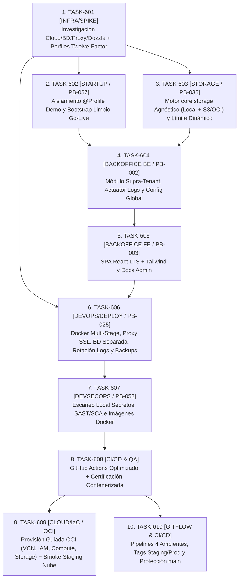

# ☁️ Sprint 6 Planning — Infraestructura Cloud OCI, Storage S3, DevSecOps y Backoffice SaaS en React

> **Estado del Sprint:** `ACTIVO / PLANIFICACIÓN OFICIAL ACORDADA` (`feat/sprint-6`)  
> **Política de Aislamiento de Alcance:** El núcleo funcional del ERP Restaurante (`modules.pos`, `modules.catalog`, `modules.finance`, `modules.inventory` y `frontend/`) **no se modifica en Sprint 6** (cualquier corrección post-Sprint 5 u observaciones de `observaciones_y_hallazgos.md` se gestionan de forma independiente sobre la rama `develop`).  
> **Objetivo del Sprint:** Preparar y certificar la plataforma para operación real en nube (**Oracle Cloud / OCI** como candidato principal): arquitectura Twelve-Factor multi-ambiente, base de datos PostgreSQL físicamente separada con respaldos cifrados hacia Object Storage, almacenamiento agnóstico `core.storage` (Local + S3/R2/OCI), arranque limpio Go-Live sin datos demo, Backoffice independiente en **React LTS + Tailwind** sobre módulo backend aislado `modules.backoffice`, control de logs en caliente y rotación, auditoría local DevSecOps (secretos/SAST/imágenes) y pipeline CI/CD GitHub Actions optimizado sin desperdicio de minutos.

---

## 🎯 Entregables Clave del Sprint 6

1. **Infraestructura Cloud & Rollout OCI Staging (`PB-025`):** Entorno Staging desplegado en contenedores Docker Multi-Stage detrás de Reverse Proxy SSL, con PostgreSQL separado del servidor de aplicaciones, rotación estricta de logs y respaldos automáticos cifrados en Object Storage.
2. **Almacenamiento Agnóstico `core.storage` (`PB-035`):** Proveedor intercambiable Local vs S3-Compatible (OCI Object Storage / R2 / MinIO / AWS S3) con validación de seguridad y límite de subida configurable dinámicamente desde Backoffice (`1 MB` por defecto).
3. **Backoffice SaaS Independiente (`PB-002` + `PB-003`):**
   - Módulo Spring Modulith aislado (`modules.backoffice`) exclusivo para `ROLE_SUPERADMIN`, gestión/suspensión de tenants, configuración `GLOBAL`, observabilidad Actuator y control de niveles de log en caliente.
   - SPA independiente en **`backoffice-frontend/` (React LTS + TypeScript + Tailwind)** con componentes administrativos genéricos y documentación SDD concisa orientada a administradores de plataforma.
4. **Startup Limpio Go-Live (`PB-057`):** Aislamiento `@Profile({"dev", "demo"})` de seeders de demostración y bootstrap seguro de plataforma limpia.
5. **DevSecOps & CI/CD Eficiente (`PB-058` + `PB-025`):** Suite local de escaneo de secretos/vulnerabilidades (`gitleaks` / `trivy` / `semgrep`) y workflows GitHub Actions activados únicamente en `develop` (Staging) y `release/*` / `main` (Producción), manteniendo ramas `feat/*` con `0` consumo automático.

---

## 🧭 Grafo de Dependencias y Orden de Ejecución

---

## 📋 Resumen Macro de Tareas del Sprint 6

*(Cada tarea atravesará en su ejecución individual su propio ciclo completo SDD-SDLC de Co-Diseño en Fases 1 y 2).*

1. **`TASK-601 [INFRA/SPIKE] (PB-025):`** Investigación Cloud OCI / DB Separada / Reverse Proxy / Visor de Logs y Matriz de Perfiles Twelve-Factor (`dev`, `test`, `staging`, `prod` + runtime config en SPAs).
2. **`TASK-602 [STARTUP/SEGURIDAD] (PB-057):`** Aislamiento `@Profile({"dev", "demo"})` de seeders demo y Bootstrap Limpio Go-Live + Contexto Supra-Tenant `SUPERADMIN`.
3. **`TASK-603 [STORAGE/ARQUITECTURA] (PB-035):`** Motor Agnóstico de Almacenamiento `core.storage` (Patrón Strategy: Local + S3/R2/OCI), validación MIME/*magic bytes* (sin librerías WebP redundantes) y límite máximo configurable desde Backoffice (default `1 MB`).
4. **`TASK-604 [BACKOFFICE BACKEND] (PB-002):`** Módulo aislado `modules.backoffice` (`ROLE_SUPERADMIN`), gestión/suspensión de tenants, configuración global y prueba de storage, telemetría de disco/salud Actuator y cambio dinámico de niveles de log en caliente (`/actuator/loggers`).
5. **`TASK-605 [BACKOFFICE FRONTEND] (PB-003):`** SPA independiente `backoffice-frontend/` en **React LTS + TypeScript + Tailwind CSS**, gestión de inquilinos, consola de parametría global & storage, monitor de salud/endpoints/logs en caliente y documentación técnica SDD enfocada a administradores.
6. **`TASK-606 [DEVOPS/DEPLOY] (PB-025):`** Contenerización Multi-Stage no-root (Backend, Angular ERP, React Backoffice), configuración de rotación estricta de logs (Logback + Docker), Reverse Proxy SSL, BD PostgreSQL separada y scripts de backup/restore cifrados hacia Object Storage.
7. **`TASK-607 [DEVSECOPS/SEGURIDAD] (PB-058):`** Escaneo Local de Seguridad y Secretos (`gitleaks`, `trivy`, `npm audit`, SAST) sobre código fuente, dependencias e imágenes Docker antes de publicar en nube.
8. **`TASK-608 [CI/CD & QA] (PB-025):`** Pipeline GitHub Actions optimizado (0 ejecución automática en `feat/*`, caché + *path filters* en `develop`/`release/*`/`main`) y Certificación Smoke del stack Dockerizado.
9. **`TASK-609 [CLOUD / IaC] (OCI):`** Provisión guiada de Oracle Cloud Infrastructure (evaluación IaC OpenTofu/Terraform vs OCI CLI, IAM/Compartments/Budgets, VCN Zero-Trust, Compute Ampere VM1/VM2, Object Storage) + Certificación Smoke HTTPS Staging en Nube.
10. **`TASK-610 [DEVOPS/CI-CD] (GITFLOW):`** Gobernanza de 4 ambientes (`dev`, `testing-local`, `staging`, `prod`), disparadores por tags (`v*-rc.*` para Staging, `v*.*.*` en `main` para Producción), cero desperdicio al pushear a `develop`/`release/*` y reglas de protección de ramas en GitHub.
