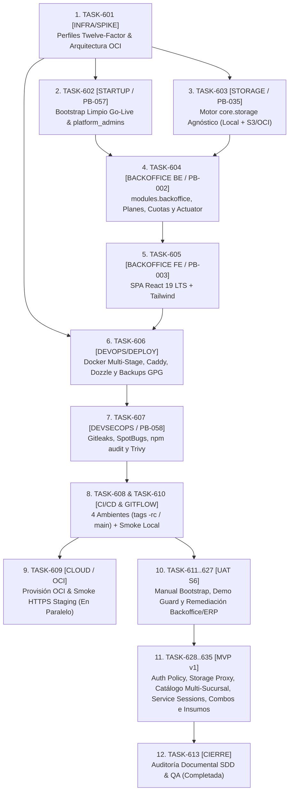

# ☁️ Sprint 6 Planning — Infraestructura Cloud OCI, Storage S3, DevSecOps, Backoffice SaaS y Estabilización MVP v1

> **Rama Activa de Estabilización y Release:** `release/sprint-6` (entorno `testing-local` dockerizado)  
> **Histórico de Tareas Completadas:** [`sprint_06_backlog.md`](./sprint_06_backlog.md)  
> **Backlog Activo / Cierre:** [`docs/tasks.md`](../../tasks.md)  
> **Objetivo del Sprint:** Preparar y certificar la plataforma multi-tenant para despliegue en nube (**Oracle Cloud / OCI**): arquitectura Twelve-Factor multi-ambiente (`dev`, `testing-local`, `staging`, `prod`), base de datos PostgreSQL separada con respaldos cifrados hacia Object Storage, almacenamiento agnóstico `core.storage` (Local + S3/R2/OCI), arranque limpio Go-Live sin datos demo, Backoffice independiente en **React 19 LTS + Tailwind** sobre módulo backend aislado `modules.backoffice`, control de logs en caliente y rotación, auditoría local DevSecOps, pipelines GitHub Actions 4 ambientes y **bloque integral de estabilización MVP v1 (`TASK-611`–`TASK-635`)** tras pruebas conjuntas de Backoffice y ERP.

---

## 🎯 Entregables Clave del Sprint 6

1. **Infraestructura Cloud & Rollout OCI Staging (`PB-025`):**
   - Contenerización Docker Multi-Stage Non-Root (`backend`, `erp-frontend`, `backoffice-frontend`) detrás de Caddy Reverse Proxy + visor Dozzle (`testing-local`), rotación estricta de logs y scripts de backup/restore cifrados GPG AES-256.
   - Provisión guiada de Oracle Cloud (`TASK-609`, ejecutada en paralelo) y certificación HTTPS Staging en nube.
2. **Almacenamiento Agnóstico `core.storage` (`PB-035`):**
   - Proveedor intercambiable `LOCAL` vs S3-Compatible (OCI Object Storage / R2 / MinIO / AWS S3), validación *magic bytes*, límite configurable desde Backoffice y resolución cross-origin de `/uploads/*` en Caddy y frontend (`TASK-603`, `TASK-629`).
3. **Backoffice SaaS Independiente (`PB-002` + `PB-003`):**
   - Módulo Spring Modulith aislado (`modules.backoffice`) + `core.entitlements` exclusivo para administradores de plataforma, gestión/suspensión de tenants, planes categorizados y gratuitos ilimitados, usuarios de tenant, configuración `GLOBAL`, auditoría paginada y loggers en caliente (`/actuator/loggers`).
   - SPA independiente en **`backoffice-frontend/` (React 19 LTS + TypeScript + Tailwind)** con modo oscuro persistente y primitivas UI compartidas (`TASK-605`, `TASK-616`–`TASK-625`).
4. **Startup Limpio Go-Live (`PB-057`):**
   - Aislamiento `@Profile({"dev", "test"})` de seeders de demostración, bootstrap seguro de `platform_admins`, ocultamiento de botones demo fuera de `dev` (`TASK-602`, `TASK-612`) y manual [`bootstrap_y_operacion_inicial.md`](../../manuals/plataforma/bootstrap_y_operacion_inicial.md) (`TASK-611`).
5. **DevSecOps & GitFlow 4 Ambientes (`PB-058` + `TASK-610`):**
   - Suite local de escaneo de secretos/SAST/SCA/imágenes Docker (`run-security-scan.sh`).
   - Workflows GitHub Actions alineados a los **4 ambientes**:
     - `dev`: ramas `feat/*` y `develop` (sin disparos pesados por push directo a `develop`; CI en PRs o `workflow_dispatch`).
     - `testing-local`: rama `release/sprint-X` sobre `docker-compose.testing-local.yml` (cero disparos a Staging Nube).
     - `staging`: únicamente al publicar tags **`vX.Y.Z-rc.N`** / **`vX.Y.Z-staging.N`** (o `workflow_dispatch`) $\rightarrow$ `cd-staging.yml`.
     - `prod`: PR aprobado hacia **`main`** + tag SemVer final **`vX.Y.Z`** $\rightarrow$ `cd-production.yml` con compuerta de aprobación manual en Environment `production`.
6. **Bloque de Estabilización MVP v1 (`TASK-614`–`TASK-635` + Pulido E2E, `PB-060`):**
   - Remediación UAT en Backoffice y ERP sobre `release/sprint-6`: políticas de `mustChangePassword` configurables (`TASK-628`), edición de platos y categorías (`TASK-631`), aislamiento por sucursal por defecto (`catalog.scope_mode`) y clonado a sucursal destino (`TASK-632`), jornadas compartidas de sucursal (`branch_service_sessions`, `V23`), combos dinámicos `MENU_COURSE`, plantillas multi-día (`V24`), cupos ilimitados, grupos de complementos (`TASK-634`), saneamiento CRUD de insumos (`TASK-635`) y correcciones post-E2E en POS/RBAC/UI.

---

## 🧭 Grafo de Dependencias y Evolución del Sprint 6

---

## 📋 Resumen Macro de Bloques del Sprint 6

1. **Bloque Cloud, Backoffice y DevSecOps (`TASK-601`–`TASK-608`, `TASK-610`):** Completado y verificado localmente en [`sprint_06_backlog.md`](./sprint_06_backlog.md#fase-1--fundación-cloud-backoffice-saas-storage-agnóstico-devsecops-y-gitflow).
2. **Bloque UAT Pre-Release y Backoffice/ERP (`TASK-611`, `TASK-612`, `TASK-614`–`TASK-618`, `TASK-620`–`TASK-627`):** Completado en `release/sprint-6` (salto deliberado de `TASK-619`).
3. **Bloque Estabilización MVP v1 y Cierre Documental (`TASK-628`–`TASK-635` + `TASK-613` + Pulido E2E `V23`–`V24`):** Completado en `release/sprint-6` (`sprint_06_backlog.md`) con cobertura unitaria, integración y validación documental completa.
4. **Cierre Paralelo e Integración Final (`TASK-609` + Backlog Futuro):** Activos en [`docs/tasks.md`](../../tasks.md) (`TASK-609` OCI en paralelo y evolución planificada `TASK-636`–`TASK-640`).
