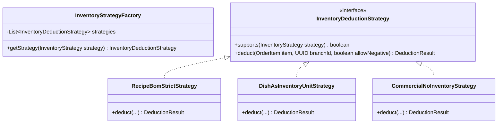

# 02. Especificación Técnica de Backend

> [!NOTE]
> Para la representación visual C4 de los módulos backend y sus contratos públicos, consulta:
> - **Diagrama C4 Nivel 3 (Backend Modulith):** [c4_level3_backend_modulith.md](../project/architecture/01-c4-system/c4_level3_backend_modulith.md)
> - **Secuencia de Venta y Deducción:** [sequence_pos_order_deduction.md](../project/architecture/04-behavior-and-flows/sequence_pos_order_deduction.md)

## 1. Framework y Configuración Base

- **Lenguaje:** Java 25 LTS (Amazon Corretto).
- **Framework:** Spring Boot 4.1.x / 3.4.x (según compatibilidad de dependencias en `pom.xml`).
- **Virtual Threads:** Habilitado mediante `spring.threads.virtual.enabled=true`.
- **Manejo de Errores:** `ProblemDetail` según RFC 7807 para todas las respuestas de excepción REST.
- **Validación Arquitectónica:** Spring Modulith con verificación estricta de límites de módulo.

---

## 2. IAM Híbrido y Adaptativo (Perfiles de Configuración)
- `@Profile("auth-local")`: Emite tokens JWT firmados (HMAC-SHA256 / RSA). Almacena credenciales con algoritmo de hashing Argon2id en `app_users`.
  - **Identidad Adaptativa:** Permite autenticación por `username` (identificador primario) o `email`. Soporta usuarios sin correo electrónico para operadores de cocina o cajeros cuando `tenant_settings.REQUIRE_USER_EMAIL = 'false'`.
- `@Profile("auth-oidc")`: Configura Spring Security como Resource Server (`oauth2ResourceServer().jwt()`) para validar tokens emitidos por Keycloak o proveedores OIDC externos.

---

## 3. Estructura de Paquetes (Spring Modulith)

```text
com.restaurant.app/
├── core/
│   ├── security/           # JWT, UserDetails, TenantContextHolder, OIDC
│   ├── audit/              # AuditLogService, interceptor de cambios JSONB
│   └── common/             # BaseTenantEntity, BaseBranchEntity, ProblemDetail
└── modules/
    ├── company/
    │   ├── api/            # CompanyPublicApi, BranchPublicApi, OnboardingPublicApi
    │   └── internal/       # CompanyService, BranchService, OnboardingService, controllers
    ├── configuration/
    │   ├── api/            # ConfigurationPublicApi, ParameterUpdatedEvent (ADR-0008)
    │   └── internal/       # ConfigurationService, SystemParameterCatalog, Caching
    ├── catalog/
    │   ├── api/            # CatalogPublicApi, DTOs públicos de recetas y platos
    │   └── internal/       # Entidades, repositorios y servicios internos de catálogo
    ├── inventory/
    │   ├── api/            # InventoryPublicApi, DTOs de existencias
    │   └── internal/       # KardexService, PurchaseService, listeners de deducción
    ├── pos/
    │   ├── api/            # OrderPaidEvent, DTOs de órdenes
    │   └── internal/       # OrderService, KDS, endpoints REST del POS
    ├── finance/
    │   ├── api/            # FinancePublicApi
    │   └── internal/       # CashShiftService, ExpenseApprovalWorkflow, Arqueo
    └── analytics/
        └── internal/       # Cálculo de márgenes, rentabilidad y punto de equilibrio
```

---

## 4. Jerarquía Dual de Entidades Base (`core.common`)

Para respetar el principio de segregación y el modelo de datos físico, se definen dos clases base abstractas:

```java
package com.restaurant.app.core.common.domain;

import jakarta.persistence.Column;
import jakarta.persistence.MappedSuperclass;
import jakarta.persistence.Version;
import org.hibernate.annotations.CreationTimestamp;
import org.hibernate.annotations.UpdateTimestamp;
import java.time.Instant;
import java.util.UUID;

@MappedSuperclass
public abstract class BaseTenantEntity {

    @Column(name = "tenant_id", nullable = false, updatable = false)
    private UUID tenantId;

    @Version
    @Column(name = "version", nullable = false)
    private Long version;

    @CreationTimestamp
    @Column(name = "created_at", nullable = false, updatable = false)
    private Instant createdAt;

    @UpdateTimestamp
    @Column(name = "updated_at")
    private Instant updatedAt;

    public UUID getTenantId() { return tenantId; }
    public void setTenantId(UUID tenantId) { this.tenantId = tenantId; }
    public Long getVersion() { return version; }
    public Instant getCreatedAt() { return createdAt; }
    public Instant getUpdatedAt() { return updatedAt; }
}
```

```java
package com.restaurant.app.core.common.domain;

import jakarta.persistence.Column;
import jakarta.persistence.MappedSuperclass;
import java.util.UUID;

@MappedSuperclass
public abstract class BaseBranchEntity extends BaseTenantEntity {

    @Column(name = "branch_id", nullable = false, updatable = false)
    private UUID branchId;

    public UUID getBranchId() { return branchId; }
    public void setBranchId(UUID branchId) { this.branchId = branchId; }
}
```

### Distribución de Entidades de Dominio:
- **Extienden de `BaseTenantEntity`:** `Category`, `Ingredient`, platos maestros en `Dishes`, `TenantSetting`.
- **Extienden de `BaseBranchEntity`:** `BranchStock`, `Purchase`, `PurchaseItem`, `Order`, `OrderItem`, `CashShift`, `Expense`, `BranchDish`, `BranchSetting`.
- **Auditoría (`AuditLog`):** Extiende de `BaseTenantEntity` e incorpora un campo opcional `branchId` (nullable).

---

## 5. Sistema Unificado de Parametrización Multinivel (`modules.configuration`)

Bajo [ADR-0008](../adr/0008_unified_multilevel_parameter_system.md), la configuración dinámica evoluciona de claves libres a un **motor tipado con Registry en código, Sparse Storage y Hot-Reload concurrent**:

```java
package com.restaurant.app.modules.configuration.api;

import java.util.Optional;
import java.util.UUID;

public interface ConfigurationPublicApi {
    String getString(SystemParameter param, UUID branchId, UUID tenantId);
    boolean getBoolean(SystemParameter param, UUID branchId, UUID tenantId);
    int getInt(SystemParameter param, UUID branchId, UUID tenantId);
    double getDouble(SystemParameter param, UUID branchId, UUID tenantId);
    <E extends Enum<E>> E getEnum(SystemParameter param, UUID branchId, UUID tenantId, Class<E> enumClass);
    
    void setOverride(SystemParameter param, ParameterScope scope, UUID tenantId, UUID branchId, String value, UUID userId, String reason);
    void resetOverride(SystemParameter param, ParameterScope scope, UUID tenantId, UUID branchId);
}
```

### Endpoints REST de Alto Rendimiento (`/api/v1/parameters`):
- `GET /api/v1/parameters?scope={BRANCH|TENANT}&category={POS|INVENTORY|...}`: Carga diferida por categoría con soporte de encabezados `ETag` (HTTP 304).
- `PATCH /api/v1/parameters/{key}`: Mutación atómica de campo individual (< 150 bytes) con actualización concurrente en memoria y emisión de `ParameterUpdatedEvent`.
- `DELETE /api/v1/parameters/{key}?scope=BRANCH&branchId={id}`: Restablece el valor al heredado de la empresa (*Reset to Default*).

---

## 6. Contratos de Comunicación Inter-Módulo (Spring Modulith)

Queda estrictamente prohibido inyectar repositorios o servicios internos de un módulo en otro. La comunicación se realiza exclusivamente mediante interfaces públicas en el paquete `.api` o mediante eventos asíncronos.

### A. API Pública de Catálogo (`modules.catalog.api`):

```java
package com.restaurant.app.modules.catalog.api;

import java.math.BigDecimal;
import java.util.List;
import java.util.Optional;
import java.util.UUID;

public interface CatalogPublicApi {

    record RecipeItemDto(UUID ingredientId, String ingredientName, BigDecimal quantity, String unitOfMeasure) {}
    record DishRecipeDto(UUID dishId, String dishName, List<RecipeItemDto> items) {}

    Optional<DishRecipeDto> getRecipeForDish(UUID tenantId, UUID dishId);
}
```

### B. Evento Emitido por POS al Cobrar un Ticket:

```java
package com.restaurant.app.modules.pos.api;

import java.math.BigDecimal;
import java.time.Instant;
import java.util.List;
import java.util.UUID;

public record OrderPaidEvent(
    UUID orderId,
    UUID tenantId,
    UUID branchId,
    String ticketNumber,
    List<OrderItemDto> items,
    BigDecimal totalAmount,
    String paymentMethod,
    Instant timestamp
) {
    public record OrderItemDto(UUID dishId, String dishName, int quantity, BigDecimal unitPrice) {}
}
```

### C. Consumidor en el Módulo Inventory:

```java
package com.restaurant.app.modules.inventory.internal;

import com.restaurant.app.modules.pos.api.OrderPaidEvent;
import org.springframework.modulith.events.ApplicationModuleListener;
import org.springframework.stereotype.Component;

@Component
class InventoryEventListener {

    private final KardexService kardexService;

    InventoryEventListener(KardexService kardexService) {
        this.kardexService = kardexService;
    }

    @ApplicationModuleListener
    void on(OrderPaidEvent event) {
        kardexService.processOrderDeduction(event);
    }
}
```

### D. API Pública de Onboarding y Alta Rápida (`modules.company.api`):

```java
package com.restaurant.app.modules.company.api;

import java.util.UUID;

public interface OnboardingPublicApi {

    record OnboardingCompanyDto(String legalName, String slug, String nitOrTaxId, String logoUrl) {}
    record OnboardingBranchDto(String name, String address, Double latitude, Double longitude, String phone) {}
    record OnboardingAdminDto(String fullName, String username, String email, String password) {}
    
    record OnboardingRequest(
        OnboardingCompanyDto company,
        OnboardingBranchDto branch,
        String businessTemplate, // FAST_FOOD, TRADITIONAL, CAFE, EMPTY
        boolean includeDemoCatalog,
        OnboardingAdminDto adminUser
    ) {}

    record OnboardingResultDto(
        UUID tenantId,
        UUID branchId,
        UUID adminUserId,
        String slug,
        String accessToken,
        String refreshToken
    ) {}

    record CheckAvailabilityResultDto(boolean available, String suggestedAlternative) {}

    CheckAvailabilityResultDto checkSlugAvailability(String slug);
    CheckAvailabilityResultDto checkNitAvailability(String nit);
    OnboardingResultDto executeOnboarding(OnboardingRequest request);
}
```

- **Endpoints Expuestos (`OnboardingController`):**
  - `POST /api/v1/auth/onboarding`: Orquesta atómicamente la creación de la empresa, sucursal, usuario administrador con hash Argon2id, aprovisionamiento de parámetros operativos semilla según la plantilla elegida ([ADR-0008](../../adr/0008_unified_multilevel_parameter_system.md) y [ADR-0009](../../adr/0009_tenant_onboarding_and_operational_presets.md)) y 3 productos demo. Retorna sesión activa JWT.
  - `GET /api/v1/auth/onboarding/check-availability?slug=...&nit=...`: Valida disponibilidad con debounce en tiempo real para el asistente frontend.

### E. API Pública de Seguridad, Roles y RBAC (`core.security.api`):

Bajo [ADR-0010](../adr/0010_granular_rbac_roles_and_privileges.md), se formalizan los contratos para la gestión dinámica de roles, permisos agrupados y asignación multi-sucursal:

```java
package com.restaurant.app.core.security.api;

import java.time.Instant;
import java.util.List;
import java.util.Optional;
import java.util.Set;
import java.util.UUID;

public interface RolePublicApi {

    record PermissionCatalogItemDto(String code, String name, String description, String module) {}
    record RoleDto(UUID id, UUID tenantId, String code, String name, String description, boolean isSystem, Set<String> permissions) {}
    record CreateRoleRequest(String code, String name, String description, Set<String> permissions) {}
    record UpdateRoleRequest(String name, String description, Set<String> permissions) {}

    record ResetPasswordRequest(String temporaryPassword) {}
    record ResetPasswordResponse(UUID userId, boolean mustChangePassword, Instant resetAt) {}
    record ChangePasswordRequest(String currentPassword, String newPassword) {}

    record AssignBranchesRequest(UUID defaultBranchId, Set<UUID> authorizedBranchIds) {}

    List<RoleDto> listRoles(UUID tenantId);
    Optional<RoleDto> getRole(UUID tenantId, UUID roleId);
    RoleDto createRole(UUID tenantId, CreateRoleRequest request);
    RoleDto updateRole(UUID tenantId, UUID roleId, UpdateRoleRequest request);
    void deleteRole(UUID tenantId, UUID roleId);

    List<PermissionCatalogItemDto> getPermissionsCatalog();

    ResetPasswordResponse resetUserPassword(UUID callerId, UUID targetUserId, ResetPasswordRequest request);
    void changeOwnPassword(UUID userId, ChangePasswordRequest request);
    void assignUserBranches(UUID tenantId, UUID targetUserId, AssignBranchesRequest request);
}
```

- **Endpoints Expuestos (`RoleController`, `UserSecurityController`):**
  - `GET /api/v1/roles`: Lista los roles configurados en la empresa (excluye `ADMIN_TENANT` de mutaciones).
  - `POST /api/v1/roles`: Crea un nuevo rol personalizado con su conjunto de permisos atómicos.
  - `PUT /api/v1/roles/{id}`: Actualiza nombre, descripción y matriz de permisos de un rol no protegido.
  - `DELETE /api/v1/roles/{id}`: Elimina un rol custom (rechaza con HTTP 409 si tiene usuarios activos asignados).
  - `GET /api/v1/permissions/catalog`: Catálogo tipado de permisos agrupados por módulo (`POS`, `INVENTORY`, `FINANCE`, `CATALOG`, `REPORTS`, `ADMIN`) para renderizar matrices en UI.
  - `POST /api/v1/users/{id}/reset-password`: Reseteo delegado de contraseñas por jerarquía administrativa sin requerir correo saliente (marca `must_change_password = true`).
  - `POST /api/v1/users/{id}/branches`: Asigna la lista de sucursales autorizadas y la sucursal predeterminada.
  - `POST /api/v1/auth/change-password`: Cambio de contraseña obligatorio privado para el usuario que ingresa con flag `must_change_password`.

### F. API de Gestión de Sesiones y Silent Refresh (`core.security.api`):

Bajo [ADR-0011](../adr/0011_session_lifecycle_and_silent_refresh.md), el ciclo de vida de sesiones implementa rotación de tokens criptográficos y revocación multidispositivo:

```java
package com.restaurant.app.core.security.api;

import java.time.Instant;
import java.util.List;
import java.util.UUID;

public interface SessionPublicApi {

    record RefreshRequest(String refreshToken) {}
    record RefreshResponse(String accessToken, String refreshToken, String tokenType, long expiresInSeconds) {}
    record ActiveSessionDto(UUID id, String deviceInfo, String ipAddress, Instant createdAt, Instant expiresAt, boolean isCurrent) {}

    RefreshResponse refreshSession(RefreshRequest request, String ipAddress, String userAgent);
    void revokeCurrentSession(String refreshToken);
    void revokeAllUserSessions(UUID userId);
    List<ActiveSessionDto> listActiveSessions(UUID userId, String currentTokenHash);
}

public interface DailyMenuPublicApi {

    record CreateMenuTemplateCmd(String name, String description, String dayOfWeek, String priceMode, BigDecimal packagePrice, List<CreateMenuItemCmd> items) {}
    record CreateMenuItemCmd(UUID dishId, String courseType, int suggestedQuota, BigDecimal overridePrice, boolean isMandatoryInPackage, int sortOrder) {}
    record MenuTemplateDto(UUID id, String name, String description, String dayOfWeek, String priceMode, BigDecimal packagePrice, boolean isTemplate, boolean isActive, List<MenuItemDto> items) {}
    record MenuItemDto(UUID id, UUID dishId, String dishName, String courseType, int suggestedQuota, BigDecimal effectivePrice, boolean isMandatoryInPackage, int sortOrder) {}

    record ShiftMenuDto(UUID id, UUID shiftId, UUID menuId, String menuName, List<ShiftMenuItemDto> items) {}
    record ShiftMenuItemDto(UUID id, UUID dishId, String dishName, String courseType, int initialQuota, int currentQuota, int soldCount, BigDecimal effectivePrice, boolean isSoldOut, long version) {}
    record ShiftQuotaAdjustmentDto(UUID id, UUID shiftMenuItemId, int quantityDelta, String reason, UUID adjustedBy, Instant createdAt) {}

    MenuTemplateDto createTemplate(UUID tenantId, UUID branchId, CreateMenuTemplateCmd cmd);
    MenuTemplateDto getTemplateById(UUID tenantId, UUID menuId);
    List<MenuTemplateDto> listTemplates(UUID tenantId, UUID branchId, String dayOfWeek);
    ShiftMenuDto instantiateForShift(UUID tenantId, UUID branchId, UUID shiftId, UUID menuTemplateId, Map<UUID, Integer> customQuotas, UUID assignedBy);
    ShiftMenuDto getShiftMenu(UUID tenantId, UUID shiftId);
    ShiftMenuItemDto adjustQuota(UUID tenantId, UUID shiftId, UUID itemId, int delta, String reason, UUID adjustedBy);
}
```

- **Endpoints Expuestos (`AuthController`, `SessionController`, `MenuController`):**
  - `POST /api/v1/auth/refresh`: Valida el hash SHA-256 del refresh token, ejecuta rotación atómica y expide un nuevo par (Access 15 min + Refresh 7 días). Si el token ya había sido revocado, activa el protocolo de compromiso e invalida todas las sesiones del usuario.
  - `POST /api/v1/auth/logout`: Revoca el refresh token presentado (`revoked_at = NOW()`).
  - `POST /api/v1/auth/revoke-all`: Revoca masivamente todas las sesiones activas del usuario (botón de pánico o cambio de clave).
  - `GET /api/v1/auth/sessions`: Lista de sesiones activas del colaborador para auditoría en "Mi Perfil".
  - `POST /api/v1/catalog/menus`: Registro de nuevas plantillas de menús diarios reutilizables.
  - `GET /api/v1/catalog/menus`: Listado de plantillas filtrables por `templateOnly=true` y `dayOfWeek`.
  - `GET /api/v1/catalog/shifts/{shiftId}/menu`: Consulta del menú activo instanciado en el turno con cupos en vivo.
  - `POST /api/v1/catalog/shifts/{shiftId}/menu-items/{itemId}/adjust-quota`: Ampliación/reducción auditada de cupos en vivo.

---

## 7. Patrón Strategy: Tríada de Inventario y Kardex Flexible (PB-044)

El módulo de inventario procesa el evento de dominio `OrderPaidEvent` aplicando una arquitectura desacoplada basada en el **Strategy Pattern**:



1. **`RECIPE_BOM_STRICT` (Receta BOM Estricta):** Descuenta insumos desde `dish_recipes` valorizados al costo promedio ponderado en `branch_stock` y genera movimientos inmutables `SALE_OUT` en `kardex_movements` (`ingredient_id != null`, `dish_id = null`).
2. **`DISH_AS_INVENTORY_UNIT` (Plato como Unidad en Almacén):** El plato terminado se administra como producto físico en almacén. Descuenta existencias directamente de `branch_stock` (`dish_id != null`, `ingredient_id = null`) y asienta `SALE_OUT` en `kardex_movements` con el costo unitario del plato.
3. **`COMMERCIAL_NO_INVENTORY` (Venta Libre Comercial):** Omite la afectación de almacén y Kardex, permitiendo operaciones ágiles para ítems comerciales sin control de stock.

### Control de Saldo Negativo Multinivel (`inventory.allow_negative_stock`)
- Si `false` (Modo Estricto): El backend verifica existencias antes de confirmar el ticket. Si no hay suficiente stock, arroja `InsufficientStockException` (HTTP 409 `INSUFFICIENT_STOCK_ERROR`).
- Si `true` (Modo Permisivo): Descuenta stock permitiendo valores negativos temporales para no interrumpir el despacho y genera advertencias de auditoría `STOCK_DEFICIT_WARNING`.
- Cada plato puede sobrescribir esta política mediante `dishes.allow_negative_stock_override`.

---

## 8. Workflow de Aprobación de Gastos Menores de Caja (`modules.finance`) — ADR-0005 & ADR-0013

- **Gobernanza RBAC Pura (Sin Roles Quemados):**
  - Cualquier colaborador con permiso `finance:expenses_create` puede registrar solicitudes de egreso con cargo a gaveta (`paid_from_cash_drawer = true`).
  - Todo egreso registrado con solo este permiso nace en estado `PENDING_APPROVAL`, requiriendo `evidence_url` (foto o factura).
  - Solo colaboradores con el permiso `finance:expenses_approve` pueden autorizar o rechazar solicitudes pendientes (`POST /api/v1/finance/expenses/{id}/approve`).
- **Techo Máximo de Gaveta (`finance.max_petty_cash_expense`):**
  - Parámetro por sucursal (default: $Bs.\ 100.00$). Cualquier retiro de gaveta superior a este límite es bloqueado con HTTP 400 para proteger la liquidez del turno.
- **Autoaprobación Configurable (`finance.expense_allow_self_approval`):**
  - Si un usuario posee `finance:expenses_approve` y registra un gasto propio: se autoaprueba solo si el parámetro está en `true` o si es el dueño (`ADMIN_TENANT`). En caso contrario, requiere control dual (`PENDING_APPROVAL`).
- **Impacto Matemático en Arqueo:**
  - Únicamente los gastos con `approval_status = 'APPROVED'` y pagados en efectivo se descuentan del efectivo teórico esperado en gaveta:
    $$\text{expected\_cash} = \text{initial\_cash} + \text{total\_cash\_sales} - \text{total\_cash\_expenses}_{\text{approved}}$$

---

## 9. Invariante Transaccional de Turno Abierto en POS (`modules.pos`) — ADR-0013

- **Inyección Intermodular:** `OrderServiceImpl` inyecta `FinancePublicApi`.
- **Validación Férrea en `createOrder`:**
  - Al procesar una orden en estado `PAID` o `IN_PREPARATION`, el servicio invoca `financePublicApi.findActiveShift(tenantId, request.branchId())`.
  - Si no existe un turno con estado `OPEN`, lanza `ShiftRequiredException`, que se serializa automáticamente en RFC 7807 **HTTP 409 Conflict**:
    ```json
    {
      "type": "https://api.restaurant.com/errors/shift-required",
      "title": "Turno de Caja Requerido",
      "status": 409,
      "detail": "No es posible registrar ventas: la caja de la sucursal se encuentra cerrada."
    }
    ```
  - Si existe turno activo, asigna mandatoriamente `order.setCashShiftId(activeShift.id())`.
- **Trazabilidad Relacional de Cajero:**
  - `orders.user_id` vincula relacionalmente al usuario que generó el cobro (`TenantContextHolder.getUserId()`).
  - `OrderDto` expone `UUID cashierId` para consumo de frontend y emisión de comprobantes.

---

## 10. Menús Diarios, Cupos Transaccionales y Migración Flyway V9 (ADR-0015 & PB-034)

### 10.1. Especificación de la Migración `V9__daily_menus_and_flexible_inventory.sql`

> *Nota de Secuencia Flyway:* Dado que las versiones V5..V8 fueron previamente consolidadas en el repositorio para valores de parámetros (`V5`), onboarding y datos fiscales (`V6`), roles RBAC dinámicos (`V7`) y refresh tokens de sesión (`V8`), la migración de menús diarios e inventario flexible fue implementada bajo el número secuencial `V9__daily_menus_and_flexible_inventory.sql`.

```sql
-- 1. Tablas de Plantillas Reutilizables de Menú
CREATE TABLE daily_menus (
    id UUID PRIMARY KEY DEFAULT gen_random_uuid(),
    tenant_id UUID NOT NULL REFERENCES tenants(id) ON DELETE CASCADE,
    branch_id UUID REFERENCES branches(id) ON DELETE CASCADE,
    name VARCHAR(120) NOT NULL,
    description TEXT,
    day_of_week VARCHAR(15),
    price_mode VARCHAR(25) NOT NULL DEFAULT 'INDIVIDUAL_ITEMS',
    package_price NUMERIC(12,2),
    is_template BOOLEAN NOT NULL DEFAULT TRUE,
    is_active BOOLEAN NOT NULL DEFAULT TRUE,
    created_at TIMESTAMPTZ NOT NULL DEFAULT CURRENT_TIMESTAMP,
    updated_at TIMESTAMPTZ NOT NULL DEFAULT CURRENT_TIMESTAMP,
    version BIGINT NOT NULL DEFAULT 0
);

CREATE TABLE daily_menu_items (
    id UUID PRIMARY KEY DEFAULT gen_random_uuid(),
    menu_id UUID NOT NULL REFERENCES daily_menus(id) ON DELETE CASCADE,
    dish_id UUID NOT NULL REFERENCES dishes(id) ON DELETE RESTRICT,
    course_type VARCHAR(20) NOT NULL,
    suggested_quota INT NOT NULL DEFAULT 0 CHECK (suggested_quota >= 0),
    override_price NUMERIC(12,2),
    is_mandatory_in_package BOOLEAN NOT NULL DEFAULT FALSE,
    sort_order INT NOT NULL DEFAULT 0
);

-- 2. Tablas de Asignación de Turno y Cupos Reactivos en Vivo
CREATE TABLE shift_menu_assignments (
    id UUID PRIMARY KEY DEFAULT gen_random_uuid(),
    tenant_id UUID NOT NULL REFERENCES tenants(id) ON DELETE CASCADE,
    branch_id UUID NOT NULL REFERENCES branches(id) ON DELETE CASCADE,
    cash_shift_id UUID NOT NULL REFERENCES cash_shifts(id) ON DELETE CASCADE,
    menu_id UUID REFERENCES daily_menus(id) ON DELETE SET NULL,
    assigned_by UUID NOT NULL REFERENCES app_users(id),
    assigned_at TIMESTAMPTZ NOT NULL DEFAULT CURRENT_TIMESTAMP,
    CONSTRAINT uq_shift_menu_assignment UNIQUE (cash_shift_id)
);

CREATE TABLE shift_menu_items (
    id UUID PRIMARY KEY DEFAULT gen_random_uuid(),
    shift_menu_assignment_id UUID NOT NULL REFERENCES shift_menu_assignments(id) ON DELETE CASCADE,
    dish_id UUID NOT NULL REFERENCES dishes(id) ON DELETE RESTRICT,
    course_type VARCHAR(20) NOT NULL,
    initial_quota INT NOT NULL CHECK (initial_quota >= 0),
    current_quota INT NOT NULL CHECK (current_quota >= 0),
    sold_count INT NOT NULL DEFAULT 0 CHECK (sold_count >= 0),
    effective_price NUMERIC(12,2) NOT NULL,
    is_sold_out BOOLEAN NOT NULL DEFAULT FALSE,
    version BIGINT NOT NULL DEFAULT 0,
    CONSTRAINT uq_shift_menu_item UNIQUE (shift_menu_assignment_id, dish_id)
);

CREATE TABLE shift_menu_quota_adjustments (
    id UUID PRIMARY KEY DEFAULT gen_random_uuid(),
    shift_menu_item_id UUID NOT NULL REFERENCES shift_menu_items(id) ON DELETE CASCADE,
    adjusted_by UUID NOT NULL REFERENCES app_users(id),
    quantity_delta INT NOT NULL,
    reason VARCHAR(255) NOT NULL,
    created_at TIMESTAMPTZ NOT NULL DEFAULT CURRENT_TIMESTAMP
);

-- 3. Modificaciones a Tablas Maestras para Inventario Flexible (PB-044)
ALTER TABLE dishes
    ADD COLUMN inventory_strategy VARCHAR(30) NOT NULL DEFAULT 'RECIPE_BOM_STRICT',
    ADD COLUMN allow_negative_stock_override BOOLEAN;

ALTER TABLE branch_stock
    ALTER COLUMN ingredient_id DROP NOT NULL,
    ADD COLUMN dish_id UUID REFERENCES dishes(id) ON DELETE RESTRICT,
    ADD CONSTRAINT chk_branch_stock_target CHECK (
        (ingredient_id IS NOT NULL AND dish_id IS NULL) OR
        (ingredient_id IS NULL AND dish_id IS NOT NULL)
    );

ALTER TABLE kardex_movements
    ALTER COLUMN ingredient_id DROP NOT NULL,
    ADD COLUMN dish_id UUID REFERENCES dishes(id) ON DELETE RESTRICT,
    ADD CONSTRAINT chk_kardex_target CHECK (
        (ingredient_id IS NOT NULL AND dish_id IS NULL) OR
        (ingredient_id IS NULL AND dish_id IS NOT NULL)
    );

-- Índices de Rendimiento
CREATE INDEX idx_daily_menus_tenant ON daily_menus(tenant_id, is_active, is_template);
CREATE INDEX idx_daily_menu_items_menu ON daily_menu_items(menu_id, sort_order);
CREATE INDEX idx_shift_menu_assignment_shift ON shift_menu_assignments(cash_shift_id);
CREATE INDEX idx_shift_menu_items_lookup ON shift_menu_items(shift_menu_assignment_id, dish_id);
CREATE INDEX idx_shift_quota_adjustments_item ON shift_menu_quota_adjustments(shift_menu_item_id, created_at);
```

### 10.2. Garantías de Concurrencia y Decremento Atómico en POS

Para garantizar consistencia transaccional ACID ante múltiples terminales POS:
1. `ShiftMenuItem` incorpora `@Version private Long version`.
2. La reducción de cupos se ejecuta mediante consulta SQL nativa condicionada:
   ```sql
   UPDATE shift_menu_items
   SET current_quota = current_quota - :qty,
       sold_count = sold_count + :qty,
       is_sold_out = CASE WHEN (current_quota - :qty) = 0 THEN TRUE ELSE FALSE END,
       version = version + 1
   WHERE id = :id AND current_quota >= :qty AND version = :version;
   ```
3. Si filas actualizadas es igual a 0, se arroja `ItemSoldOutException`, mapeada a RFC 7807 **HTTP 409 Conflict**:
   ```json
   {
     "type": "https://api.restaurant.com/errors/item-sold-out",
     "title": "Plato Agotado o Cupo Insuficiente",
     "status": 409,
     "detail": "El plato 'Milanesa de Res' solo dispone de 1 raciones y se solicitaron 2."
   }
   ```

---

## 11. Reglas de Validación Arquitectónica (JUnit)

La integridad de los módulos se valida automáticamente en la suite de pruebas unitarias:

```java
package com.restaurant.app;

import org.junit.jupiter.api.Test;
import org.springframework.modulith.core.ApplicationModules;

class ModularityTests {

    @Test
    void verifyModularity() {
        ApplicationModules.of(RestaurantApplication.class).verify();
    }
}
```

---

## 12. Modificadores, Complementos y Deducción Kardex (ADR-0018 & PB-020)

### 12.1. Modelo Relacional y Entidades
- **`ModifierGroup` (`modifier_groups`):**
  - Define `id`, `tenantId`, `name`, `minSelectable`, `maxSelectable`, `isRequired`.
- **`Modifier` (`modifiers`):**
  - Define `id`, `tenantId`, `groupId`, `name`, `additionalPrice`, `ingredientId`, `quantityConsumed`, `isActive`, `sortOrder`.
- **`OrderItem` (`order_items`):**
  - Cabecera del plato vendido: `dishId`, `quantity`, `unitPrice` (precio efectivo base + sumatoria de extras), `subtotal`, `notes` (notas libres de cocina).
- **`OrderItemModifier` (`order_item_modifiers`):**
  - Snapshot inmutable: `orderItemId`, `modifierId`, `modifierName`, `unitPrice` (`additionalPrice`), `ingredientId`, `quantityConsumed`.

### 12.2. Contratos DTO y Endpoints POS
- **`CreateOrderItemRequest`:**
  - `dishId` (UUID, requerido)
  - `quantity` (int $\ge 1$)
  - `unitPrice` (BigDecimal)
  - `notes` (String opcional, notas para cocina)
  - `selectedModifiers` (List<`SelectedModifierRequest`>)
- **`SelectedModifierRequest`:**
  - `modifierId` (UUID)
  - `name` / `modifierName` (String)
  - `additionalPrice` (BigDecimal $\ge 0$)
  - `ingredientId` (UUID opcional)
  - `quantityConsumed` (BigDecimal $\ge 0$)

### 12.3. Evento Transaccional y Deducción en Kardex
- Al cobrarse la orden, se emite `OrderPaidEvent`.
- `KardexService` consume el evento mediante `@ApplicationModuleListener`:
  1. Deduce la receta del plato base.
  2. Itera sobre `order_item_modifiers`: si `ingredientId != null` y `quantityConsumed > 0`, emite `KardexMovement` con tipo `SALE_CONSUMPTION` y decrementa `branch_stock`:
     $$\Delta\text{Stock} = -(\text{quantityConsumed} \times \text{item.quantity})$$
  3. Si `ingredientId == null`, se ignora el impacto en Kardex (concepto comercial o de servicio sin stock).

---

## 13. Cancelación de Pedidos, Motor de Autorizaciones de Turno y Mermas (ADR-0019 & PB-031)

### 13.1. Máquina de Estados y Atributos de Cancelación en `orders`
- **Estado Inmutable `CANCELLED`:**
  - Válido únicamente como transición desde `PAID`.
  - Columnas añadidas: `cancellation_reason` (VARCHAR(30)), `cancellation_notes` (TEXT), `cancelled_at` (TIMESTAMPTZ), `cancelled_by` (UUID), `cancellation_authorized_by` (UUID), `refund_method` (VARCHAR(20)), `waste_policy_applied` (VARCHAR(30)).

### 13.2. Motor Unificado de Autorizaciones de Turno (`modules.finance`)
- **Entidad `ShiftAuthorization` (`shift_authorizations`):**
  - Campos: `id`, `tenantId`, `branchId`, `cashShiftId` (nullable), `requestType` (`EXPENSE`, `ORDER_CANCELLATION`), `referenceId` (UUID de la orden o gasto), `requestedBy`, `amount`, `status` (`PENDING`, `APPROVED`, `REJECTED`), `justification`, `decidedBy`, `decisionNotes`, `decisionChannel` (`IN_SITU_PIN`, `REMOTE_SESSION`), `createdAt`, `decidedAt`.
- **PIN Rápido de Supervisor:**
  - Almacenado como hash BCrypt en `app_users.pin_hash`.
  - Validación in-situ: el endpoint `POST /api/v1/pos/orders/{id}/cancel` recibe `supervisorPin` y procesa la verificación y anulación en una sola transacción si el supervisor tiene permisos de aprobación.

### 13.3. Manejo Financiero en `cash_shifts`
- Si `refund_method == 'CASH'`:
  - Se incrementa `cash_shifts.total_cash_refunds`.
  - La fórmula de arqueo esperado se actualiza a:
    $$\text{Efectivo Esperado} = \text{Saldo Inicial} + \text{Ventas Efectivo} - \text{Gastos Efectivo} - \text{Devoluciones Efectivo}$$

### 13.4. Consumo Asíncrono en Kardex (`OrderCancelledEvent`)
- Al emitirse `OrderCancelledEvent`, `KardexService`:
  - Si `wasPrepared == false` $\rightarrow$ Registra `CANCELLATION_REVERSAL` y devuelve insumos a `branch_stock`.
  - Si `wasPrepared == true`:
    - Evalúa `pos.cancellation_prepared_waste_policy`:
      * `ALLOW_AUTO_BUFFER_REUSE`: Inserta en tabla `prepared_dish_buffer` para despacho sin nuevo descuento de stock.
      * `STRICT_WASTE`: Registra `WASTE_ADJUSTMENT` en `kardex_movements`.


