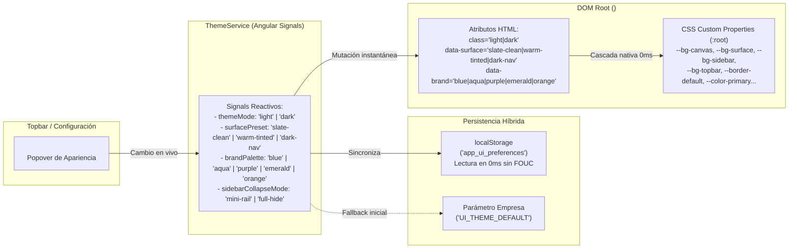
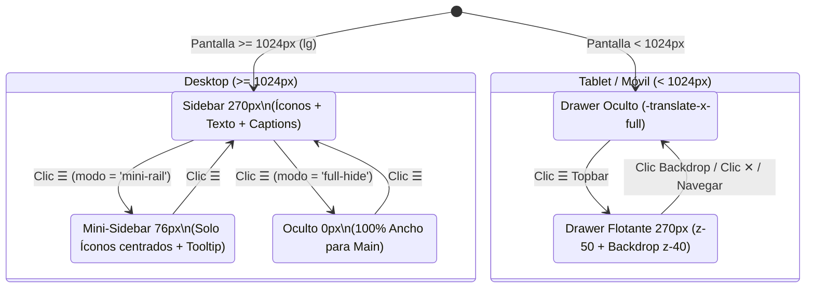

# 05. Sistema de Diseño - Especificación TailwindAdmin v3.0 (Dynamic Theme & UI Kit)

> [!IMPORTANT]
> Esta especificación define la arquitectura visual **v3.0** basada en **TailwindAdmin**, incorporando el **Motor de Temas Dinámico en Caliente (`CSS Custom Properties`)**, el **Shell Colapsable Universal (`270px` / `76px` / `0px`)**, la **Escala Canónica de Capas (`z-index`)**, la **Iconografía Vectorial Offline-First (`Solar` / `Tabler`)** y la **Suite de 8 Componentes Web Standalone (`UI Kit`)** en `frontend/src/app/shared/components/ui/`. Ver [ADR-0014](../adr/0014_tailwindadmin_v3_dynamic_theme_and_uikit.md).

---

## 1. Identidad Visual y Filosofía de Diseño

El sistema de diseño se fundamenta en la plantilla **TailwindAdmin**, perfeccionada para eliminar el efecto de "exceso de blanco" en monitores de alto brillo mediante una **jerarquía de superficies con contraste graduado** y bordes nítidos, garantizando alta velocidad operativa en terminales de Punto de Venta (POS) y paneles ERP de restaurantes.

### Principios Clave:
1. **Jerarquía de Superficies y Cero Fatiga Visual (`OBS-UI-01`):** Separación clara entre el lienzo de fondo (`--bg-canvas`: `#f1f5f9`), las superficies elevadas de tarjetas y modales (`--bg-surface`: `#ffffff`) y la barra lateral (`--bg-sidebar`), delimitadas por bordes estructurales nítidos (`1px solid #dce3ec`) y sombras multicapa suaves (`--theme-shadow-md`).
2. **Motor de Temas en Caliente (`Zero-Reload`):** Todo token de color se enlaza a **CSS Custom Properties** en `:root`. El usuario puede alternar en vivo desde el Topbar entre Modo Claro/Oscuro, 3 presets de contraste de superficie, 5 paletas de color de marca y 2 modos de colapso del menú lateral con refresco instantáneo (`0ms`).
3. **Escala Relativa y Accesibilidad (WCAG 2.2 AA):** Tipografía en unidades relativas (`rem`) sobre `DM Sans` y paleta de texto de alto contraste reforzado para insignias (`<app-badge>`) y alertas tanto en modo claro como oscuro.
4. **Iconografía Vectorial Offline-First (`Solar` + `Tabler` + Emojis):** Uso de vectores SVG oficiales de **Solar Icons** (CC BY 4.0) y **Tabler Icons** (MIT) empaquetados localmente en `<app-icon>` (cero llamadas de red para garantizar operación POS sin internet), conviviendo con emojis en etiquetas de contenido gastronómico donde aporten expresividad.

---

## 2. Tipografía y Radios de Borde

### 2.1. Tipografía Base
- **Fuente Principal:** [DM Sans](https://fonts.google.com/specimen/DM+Sans) (`"DM Sans", sans-serif`).
- **Pesos Utilizados:** Regular (`400`), Medium (`500`), SemiBold (`600`), Bold (`700`).
- **Jerarquía Tipográfica:**
  - `H1 - H6`: `font-semibold text-link dark:text-white` (Light: `#1e293b`, Dark: `#f8fafc`).
  - `Body`: `text-sm text-bodytext dark:text-darklink` (Light: `#475569`, Dark: `#94a3b8`).
  - `Card Title`: `text-lg font-semibold text-link dark:text-white`.
  - `Card Subtitle`: `text-sm text-bodytext dark:text-darklink`.
  - `Captions / Subencabezados de Menú`: `text-xs font-bold uppercase tracking-wider text-bodytext/70 dark:text-darklink/70`.

### 2.2. Radios de Borde (`Border Radius`)
- `rounded-md`: `7px` (predeterminado para cards, botones, inputs y paneles modales).
- `rounded-sm`: `4px` (insignias compactas y checkboxes).
- `rounded-lg`: `10px` (contenedores destacados y modales).
- `rounded-full`: `9999px` (avatares circulares, pills de estado con punto indicador y switches).

---

## 3. Motor de Temas Dinámico en Caliente (CSS Custom Properties)

### 3.1. Matriz de Variables CSS para Contraste de Superficies (`data-surface`)

| Variable CSS Semántica | Clase Tailwind | Opción 1: `slate-clean` (Default Recomendado) | Opción 2: `warm-tinted` (Sidebar Tinteado) | Opción 3: `dark-nav` (Sidebar Oscuro ERP) | Modo Oscuro (`.dark`) |
| :--- | :--- | :--- | :--- | :--- | :--- |
| `--bg-canvas` | `bg-canvas` / `bg-lightgray` | `#f1f5f9` (*Slate 100*) | `#f3f5f8` (*Cool Gray*) | `#f1f5f9` (*Slate 100*) | `#141c2b` (*Deep Navy*) |
| `--bg-surface` | `bg-surface` / `bg-card` | `#ffffff` (*Pure White*) | `#ffffff` (*Pure White*) | `#ffffff` (*Pure White*) | `#1e293b` (*Dark Card*) |
| `--bg-sidebar` | `bg-sidebar` | `#ffffff` (*Pure White*) | `#f8fafc` (*Tinted Slate 50*) | `#1e293b` (*Dark Navy*) | `#1e293b` (*Dark Card*) |
| `--bg-topbar` | `bg-topbar` | `rgba(255,255,255,0.92)` | `rgba(255,255,255,0.92)` | `rgba(255,255,255,0.92)` | `rgba(30,41,59,0.92)` |
| `--border-default` | `border-border` | `#dce3ec` (*Crisp Slate Border*) | `#e2e8f0` (*Slate 200*) | `#dce3ec` (*Crisp Slate Border*) | `#334155` (*Dark Border*) |
| `--border-input` | `border-bordergray` | `#cbd5e1` (*Slate 300*) | `#cbd5e1` (*Slate 300*) | `#cbd5e1` (*Slate 300*) | `#475569` (*Slate 600*) |
| `--text-heading` | `text-link` | `#1e293b` (*Slate 800*) | `#1e293b` | `#1e293b` | `#f8fafc` (*White*) |
| `--text-body` | `text-bodytext` | `#475569` (*Slate 600*) | `#475569` | `#475569` | `#94a3b8` (*Slate 400*) |
| `--sidebar-text` | `text-sidebar-text` | `#475569` | `#475569` | `#cbd5e1` (*Light on Dark*) | `#94a3b8` |
| `--sidebar-border` | `border-sidebar-border` | `#dce3ec` | `#e2e8f0` | `#334155` | `#334155` |

### 3.2. Paletas de Color de Marca en Caliente (`data-brand`)

| Preset (`brandPalette`) | `--color-primary` | `--color-primary-emphasis` | `--color-lightprimary` | `--color-secondary` | `--color-lightsecondary` |
| :--- | :---: | :---: | :---: | :---: | :---: |
| **`blue` (Default)** | `#5d87ff` | `#4570ea` | `#ecf2ff` | `#49beff` | `#e8f7ff` |
| **`aqua`** | `#0074ba` | `#00639e` | `#eff9ff` | `#47d7bc` | `#e6fffa` |
| **`purple`** | `#763ebd` | `#6434a1` | `#f4effb` | `#49beff` | `#e8f7ff` |
| **`emerald`** | `#0a7ea4` | `#096b8b` | `#f0f9ff` | `#10b981` | `#ecfdf5` |
| **`orange`** | `#fa896b` | `#e56f50` | `#fdede8` | `#0074ba` | `#eff9ff` |

### 3.3. Tokens de Estado Semántico y Alto Contraste (WCAG AA)

| Token Semántico | Base (`DEFAULT`) | Hover / Emphasis | Fondo Suave (`light*`) | Texto Alto Contraste Modo Claro (Badges/Alertas) | Texto Alto Contraste Modo Oscuro |
| :--- | :---: | :---: | :---: | :---: | :---: |
| **`success`** | `#13deb9` | `#0eb597` | `#dcfce7` | `#15803d` (*Green 700*) | `#6ee7b7` (*Emerald 300*) |
| **`warning`** | `#ffae1f` | `#e6980e` | `#fef3c7` | `#b45309` (*Amber 700*) | `#fcd34d` (*Amber 300*) |
| **`error` / `danger`** | `#fa896b` | `#e56f50` | `#ffe4e6` | `#be123c` (*Rose 700*) | `#fda4af` (*Rose 300*) |
| **`info`** | `#539bff` | `#3984ea` | `#e0f2fe` | `#0369a1` (*Sky 700*) | `#7dd3fc` (*Sky 300*) |

---

## 4. Elevación, Sombras Multicapa y Escala Canónica de `z-index`

### 4.1. Sombras Multicapa
* **Sombra General (`--theme-shadow-md`):**
  `rgba(145, 158, 171, 0.2) 0px 0px 2px 0px, rgba(145, 158, 171, 0.12) 0px 12px 24px -4px`
* **Sombra Modo Oscuro (`--theme-shadow-dark-md`):**
  `rgba(0, 0, 0, 0.35) 0px 0px 2px 0px, rgba(0, 0, 0, 0.3) 0px 12px 24px -4px`
* **Sombra Sutil (`--theme-shadow-sm`):**
  `0 1px 3px 0 rgba(16, 24, 40, 0.08), 0 1px 2px -1px rgba(16, 24, 40, 0.06)`

### 4.2. Escala Canónica de Capas (`z-index` — Solución a `OBS-UI-03` y `OBS-UI-08`)

| Nivel | Clase Tailwind | Valor `z-index` | Elementos Asignados |
| :--- | :--- | :---: | :--- |
| **Nivel 0: Contenido Base** | `z-0` / `z-10` | `0` – `10` | Tarjetas (`.card`), tablas y elementos internos de `<main>`. |
| **Nivel 1: Topbar Sticky** | `z-30` | `30` | `<header>` principal con `backdrop-blur`, garantizando que sus hijos desplegables superen a `<main>`. |
| **Nivel 2: Navegación y Popovers** | `z-40` / `z-50` | `40` – `50` | Backdrop móvil (`z-40`), Sidebar Drawer móvil (`z-50`), Dropdown de Sucursales (`z-50`) y `<app-theme-customizer>` (`z-50`). |
| **Nivel 3: Modales de Negocio** | `z-[100]` | `100` | Diálogos `<app-modal>` y `<app-bottom-sheet>`. |
| **Nivel 4: Modales Críticos** | `z-[200]` | `200` | `<app-inactivity-modal>` y `<app-product-tour>`. |
| **Nivel 5: Portal de Notificaciones** | `z-[9999]` | `9999` | `<app-toast-portal>` (alertas y errores `RFC 7807 ProblemDetail`, siempre visibles sobre cualquier modal). |

---

## 5. Especificación de la Suite de 8 Componentes Standalone (`UI Kit`)

Todos los componentes residen en `frontend/src/app/shared/components/ui/` y se exportan mediante el barrel `frontend/src/app/shared/components/ui/index.ts`.

### 5.1. `<app-icon>` (`ui/icon/icon.component.ts`)
- Renderizador vectorial Offline-First con los trazos SVG oficiales de **Solar Icons** (`stroke-width="1.5"`) y **Tabler Icons**.
- **Inputs:** `name = input.required<SolarIconName>()`, `size = input<'xs' | 'sm' | 'md' | 'lg' | 'xl'>('md')`.

### 5.2. `<app-page-wrapper>` (`ui/page-wrapper/page-wrapper.component.ts` — Solución a `OBS-UI-04`)
- Garantiza márgenes exteriores uniformes (`p-4 sm:p-6`, `max-w-[1536px] mx-auto` o `fluid` para el POS) y espaciado vertical `space-y-6`.
- **Inputs:** `title`, `subtitle`, `icon`, `emoji`, `breadcrumbs`, `fluid`.
- **Slot `[pageActions]`:** Área derecha del encabezado para colocar botones de acción principales.

### 5.3. `<app-button>` / `button[app-button]` (`ui/button/button.component.ts` — Solución a `OBS-UI-05`)
- **Variantes Semánticas (`variant`):**
  - `'primary'`: Acción afirmativa principal (*Aceptar, Guardar, Confirmar, Cobrar*).
  - `'neutral'`: Acción de cancelación o cierre (*Cancelar, Volver, Cerrar*). Borde `border-bordergray`, fondo neutro `bg-surface hover:bg-canvas`, texto secundario `text-bodytext hover:text-link`. **Prohibido usar el mismo estilo del botón primario para cancelar.**
  - `'secondary'`: Acción secundaria de apoyo.
  - `'soft-primary'` / `'outline-primary'`: Acciones intermedias o de filtro.
  - `'danger'` / `'soft-danger'`: Acciones destructivas (*Eliminar, Rechazar, Cerrar Turno*).
  - `'success'`: Confirmación de apertura o aprobación financiera.
  - `'ghost'`: Acciones limpias en cabeceras o filas de tabla.
- **Inputs:** `variant`, `size` (`'xs' | 'sm' | 'md' | 'lg' | 'icon'`), `type`, `disabled`, `loading` (spinner integrado y bloqueo de clic), `iconLeft`, `iconRight`.

### 5.4. `<app-badge>` (`ui/badge/badge.component.ts` — Solución a `OBS-UI-06`)
- **Inputs:** `color` (`'primary' | 'secondary' | 'success' | 'warning' | 'error' | 'info' | 'neutral'`), `variant` (`'soft' | 'solid' | 'outline'`), `size` (`'sm' | 'md' | 'lg'`), `dot` (`boolean`).
- En variante `'soft'`, aplica automáticamente los tonos de texto oscurecidos en Modo Claro (`#15803d`, `#b45309`, `#be123c`, `#1d4ed8`) y luminosos en Modo Oscuro para cumplir WCAG 2.2 AA.

### 5.5. `<app-card>` (`ui/card/card.component.ts` — Solución a `OBS-UI-01`)
- Tarjeta estándar con superficie `bg-surface`, borde nítido `border border-border` y sombra `--theme-shadow-md`.
- **Inputs:** `title`, `subtitle`, `noPadding`. Slots: `[cardHeaderActions]`, default body y `[cardFooter]`.

### 5.6. `<app-modal>` (`ui/modal/modal.component.ts` — Solución a `OBS-UI-05`, `OBS-UI-08`, `OBS-UI-09`)
- Diálogo accesible en `z-[100]` con backdrop `bg-slate-900/60 backdrop-blur-xs`, cierre por tecla `Escape`, cabecera fija, banner opcional de resumen de errores (`formErrorSummary`) con auto-scroll al primer campo inválido, cuerpo scrolleable y pie estandarizado (`Cancelar` neutro a la izquierda + `Confirmar` primario/danger a la derecha).

### 5.7. `<app-form-field>` (`ui/form-field/form-field.component.ts` — Solución a `OBS-UI-07` y `OBS-UI-09`)
- Envuelve controles `.form-control` (`input`, `select`, `textarea`).
- **Inputs:** `label`, `required`, `error`, `hint`, `fieldId`.
- Cuando `error()` está presente, aplica la clase `.has-error` que tiñe el borde del control hijo en rojo (`border-error! ring-2 ring-error/15`) y muestra el mensaje de validación inline debajo del input con ícono de advertencia.

### 5.8. `<app-toast-portal>` + `NotificationService` (`ui/toast-portal/` — Solución a `OBS-UI-08`)
- Portal global montado en `AppComponent` con `fixed top-4 right-4 z-[9999]`.
- Conectado automáticamente a `errorInterceptor` para proyectar cualquier `RFC 7807 ProblemDetail` por encima de modales activos (`z-[100]`).

---

## 6. Arquitectura del Shell y Menú Lateral Colapsable (`OBS-UI-02`)

- **Botón Hamburguesa Universal (`data-testid="sidebar-toggle-btn"`):** Visible en todas las resoluciones dentro del Topbar.
- **En Desktop (`>= 1024px`):** Alterna el estado `isDesktopSidebarCollapsed` de `ThemeService`:
  - Si `sidebarCollapseMode() === 'mini-rail'` (por defecto): contrae el `<aside>` de `w-[270px]` a `w-[76px]`, ocultando textos (`.hide-menu`) y secciones (`.caption`), centrando los íconos y mostrando el nombre del módulo en `title` / tooltip.
  - Si `sidebarCollapseMode() === 'full-hide'`: contrae el `<aside>` a `w-0 border-r-0 overflow-hidden`, otorgando el 100% del viewport horizontal a `<main>`.
- **En Tablet/Móvil (`< 1024px`):** Despliega el Drawer off-canvas (`w-[270px] fixed z-50`) sobre un backdrop oscuro (`z-40`).

---

## 7. Especificaciones de Breakpoints y Ergonomía Táctil (ADR-0012)

### 7.1. Breakpoints Canónicos
- **`xs` (`< 640px`):** Smartphones portrait (`360px – 430px`). 1 columna, Bottom Sheets para comanda y modales, Drawer off-canvas para menú.
- **`sm` (`640px - 767px`):** Smartphones apaisados / Phablets. Catálogo 2 columnas, tarjetas de inventario densas.
- **`md` (`768px - 1023px`):** Tablets portrait. Menú hamburguesa colapsable (Drawer), catálogo 3 columnas.
- **`lg` (`1024px - 1279px`):** Tablets apaisadas / Mostrador. Sidebar colapsable (`270px` / `76px` / `0px`), split horizontal en POS (65% catálogo / 35% comanda fija).
- **`xl` (`>= 1280px`):** Monitores de escritorio. 4 columnas en catálogo.

### 7.2. Pautas Táctiles y Accesibilidad (WCAG 2.2)
- **Objetivo Táctil Mínimo:** Todo botón, switch o tarjeta interactiva en móvil debe medir al menos $44 \times 44\text{px}$ (`min-h-[44px] min-w-[44px]`).
- **Zona del Pulgar (Thumb Zone):** Elementos críticos (barra flotante de comanda, botón de cobro) ubicados en el tercio inferior de la pantalla.
- **Safe Area Insets:** Soporte nativo para muescas y barras de gestos mediante padding: `pb-[env(safe-area-inset-bottom,12px)]`.
