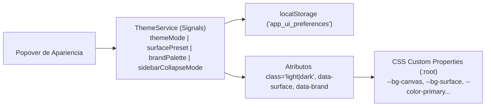
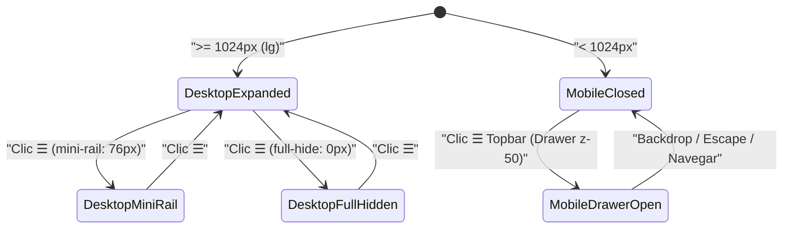

# 05. Sistema de Diseño - Especificación TailwindAdmin v3.0 (Dynamic Theme & UI Kit)

> [!IMPORTANT]
> Esta especificación define la arquitectura visual **v3.0** del ERP basada en **TailwindAdmin**, incorporando el **Motor de Temas Dinámico en Caliente (`CSS Custom Properties`)**, el **Shell Colapsable Universal (`270px` / `76px` / `0px`)**, la **Escala Canónica de Capas (`z-index`)**, la **Iconografía Vectorial Offline-First (`Solar` / `Tabler`)** y la **Suite de 13 Componentes Web Standalone (`UI Kit`)** en `frontend/src/app/shared/components/ui/` (más `BottomSheetComponent` en `shared/components/bottom-sheet/`). Ver [ADR-0014](../adr/0014_tailwindadmin_v3_dynamic_theme_and_uikit.md).
> *(Para el sistema visual en React 19 del Backoffice SaaS con variables `--bo-*` y `darkMode: 'class'`, ver [04_backoffice_frontend_react_spec.md](../backoffice/sdd/04_backoffice_frontend_react_spec.md)).*

---

## 1. Identidad Visual y Principios de Diseño

1. **Jerarquía de Superficies y Cero Fatiga Visual (`OBS-UI-01`):** Separación clara entre el lienzo de fondo (`--bg-canvas`: `#f1f5f9`), superficies elevadas (`--bg-surface`: `#ffffff`) y barra lateral (`--bg-sidebar`), con bordes nítidos (`1px solid #dce3ec`) y sombras multicapa (`--theme-shadow-md`).
2. **Motor de Temas en Caliente (`Zero-Reload`):** Variables CSS en `:root` actualizadas por `ThemeService` en `0ms` entre Modo Claro/Oscuro, 3 presets de superficie, 5 paletas de marca y 2 modos de colapso de sidebar.
3. **Escala Relativa y Accesibilidad (WCAG 2.2 AA):** Tipografía `DM Sans` en unidades `rem` y paleta de alto contraste reforzado para insignias (`<app-badge>`) en claro y oscuro.
4. **Iconografía Vectorial Offline-First:** Trazos SVG locales de **Solar Icons** (CC BY 4.0) y **Tabler Icons** (MIT) en `<app-icon>` (sin dependencias de CDN externo), junto a emojis gastronómicos en categorías/menús.

---

## 2. Tipografía y Radios de Borde

- **Fuente Principal:** `DM Sans, sans-serif` (pesos `400`, `500`, `600`, `700`).
  - `H1 - H6`: `font-semibold text-link dark:text-white`
  - `Body`: `text-sm text-bodytext dark:text-darklink`
  - `Card Title`: `text-lg font-semibold text-link dark:text-white`
- **Radios de Borde:** `rounded-sm` (`4px`), `rounded-md` (`7px`), `rounded-lg` (`10px`), `rounded-full` (`9999px`).

---

## 3. Motor de Temas Dinámico en Caliente (`ThemeService` & `frontend/src/styles.css`)

### 3.1 Superficies (`data-surface`)
| Variable CSS | Clase Tailwind | `slate-clean` (Default) | `warm-tinted` | `dark-nav` | `.dark` |
| :--- | :--- | :---: | :---: | :---: | :---: |
| `--bg-canvas` | `bg-canvas` | `#f1f5f9` | `#f3f5f8` | `#f1f5f9` | `#141c2b` |
| `--bg-surface` | `bg-surface` | `#ffffff` | `#ffffff` | `#ffffff` | `#1e293b` |
| `--bg-sidebar` | `bg-sidebar` | `#ffffff` | `#f8fafc` | `#1e293b` | `#1e293b` |
| `--bg-topbar` | `bg-topbar` | `rgba(255,255,255,0.92)` | `rgba(255,255,255,0.92)` | `rgba(255,255,255,0.92)` | `rgba(30,41,59,0.92)` |
| `--border-default` | `border-border` | `#dce3ec` | `#e2e8f0` | `#dce3ec` | `#334155` |
| `--text-heading` | `text-link` | `#1e293b` | `#1e293b` | `#1e293b` | `#f8fafc` |
| `--text-body` | `text-bodytext` | `#475569` | `#475569` | `#475569` | `#94a3b8` |

### 3.2 Paletas de Marca (`data-brand`, verificadas en `frontend/src/styles.css`)
| Preset (`brandPalette`) | `--color-primary` | `--color-primary-emphasis` | `--color-lightprimary` (Light) | `--color-secondary` |
| :--- | :---: | :---: | :---: | :---: |
| **`blue` (Default)** | `#5d87ff` | `#4570ea` | `#ecf2ff` | `#49beff` |
| **`aqua`** | `#0074ba` | `#005e96` | `#eff9ff` | `#47d7bc` |
| **`purple`** | `#763ebd` | `#61309e` | `#f4effb` | `#49beff` |
| **`emerald`** | `#0f766e` | `#0d5f59` | `#f0fdfa` | `#10b981` |
| **`orange`** | `#ea580c` | `#c2410c` | `#fff7ed` | `#0ea5e9` |

---

## 4. Elevación y Escala Canónica de `z-index`

| Nivel | Clase Tailwind | `z-index` | Elementos Asignados |
| :--- | :--- | :---: | :--- |
| **Nivel 0: Contenido Base** | `z-0` / `z-10` | `0` – `10` | Tarjetas, tablas y contenido interno de `<main>` |
| **Nivel 1: Topbar Sticky** | `z-30` | `30` | `<header>` principal con `backdrop-blur` |
| **Nivel 2: Navegación y Popovers** | `z-40` / `z-50` | `40` – `50` | Backdrop móvil (`z-40`), Sidebar Drawer (`z-50`), Dropdown Sucursales, `<app-theme-customizer>`, `<app-context-help>`, `<app-emoji-picker>` |
| **Nivel 3: Modales de Negocio** | `z-[100]` | `100` | `<app-modal>`, `<app-image-cropper-modal>` y `<app-bottom-sheet>` |
| **Nivel 4: Modales Críticos** | `z-[200]` | `200` | `<app-inactivity-modal>` y `<app-product-tour>` |
| **Nivel 5: Portal de Notificaciones** | `z-[9999]` | `9999` | `<app-toast-portal>` (errores RFC 7807 visibles sobre cualquier modal) |

---

## 5. Suite de 13 Componentes Standalone (`frontend/src/app/shared/components/ui/index.ts`)

| # | Selector | Archivo / Ubicación | Rol y Contrato Principal |
| :---: | :--- | :--- | :--- |
| 1 | **`<app-icon>`** | `ui/icon/icon.component.ts` | Renderizador SVG offline de Solar Icons y Tabler Icons (`name`, `size`) |
| 2 | **`<app-page-wrapper>`** | `ui/page-wrapper/page-wrapper.component.ts` | Lienzo canónico (`max-w-[1536px]` o `fluid`), cabecera, breadcrumbs y slot `[pageActions]` |
| 3 | **`<app-button>` / `button[app-button]`** | `ui/button/button.component.ts` | Jerarquía semántica estricta (`primary`, `neutral`, `secondary`, `soft-primary`, `outline-primary`, `danger`, `soft-danger`, `success`, `ghost`) con `[loading]` |
| 4 | **`<app-badge>`** | `ui/badge/badge.component.ts` | Insignias (`soft` \| `solid` \| `outline`, `dot`) con contraste WCAG AA en claro y oscuro |
| 5 | **`<app-card>`** | `ui/card/card.component.ts` | Tarjeta elevada (`bg-surface`, `border-border`, `--theme-shadow-md`, slots `[cardHeaderActions]` y `[cardFooter]`) |
| 6 | **`<app-modal>`** | `ui/modal/modal.component.ts` | Diálogo accesible `z-[100]`, cierre `Escape`, banner `formErrorSummary` y footer estandarizado |
| 7 | **`<app-form-field>`** | `ui/form-field/form-field.component.ts` | Wrapper de controles con estado `.has-error` y mensaje inline |
| 8 | **`<app-toast-portal>`** | `ui/toast-portal/toast-portal.component.ts` | Portal global `z-[9999]` enlazado a `NotificationService` y `errorInterceptor` |
| 9 | **`<app-theme-customizer>`** | `ui/theme-customizer/theme-customizer.component.ts` | Selector en vivo de brillo, superficie, paleta de marca y modo de colapso de sidebar |
| 10 | **`<app-authorization-queue>`** | `ui/authorization-queue/authorization-queue.component.ts` | Cola presentacional pura de autorizaciones (`authorizations`, `viewMode`, `filterType`, `filterStatus`, outputs `approve`, `reject`, `requestPin`) |
| 11 | **`<app-image-cropper-modal>`** | `ui/image-cropper-modal/image-cropper-modal.component.ts` | Recortador nativo Canvas sin deps npm (`imageFile`, `aspectRatio` 4:3, `400x300` WebP, outputs `cropped`, `cancelled`) |
| 12 | **`<app-emoji-picker>`** | `ui/emoji-picker/emoji-picker.component.ts` | Selector popover nativo de emojis gastronómicos en 6 secciones y búsqueda (`selectedEmoji`, `disabled`, `emojiSelected`) |
| 13 | **`<app-context-help>`** | `ui/context-help/context-help.component.ts` | Botón `(?)` y popover con `impact` y `example` para parámetros del sistema (`help`, `paramName`) |

*Componente móvil complementario en `shared/components/bottom-sheet/`:* **`<app-bottom-sheet>`** (`isOpen`, `title`, `maxHeight`, `dismissible`, swipe-down táctil).

---

## 6. Shell Colapsable, Breakpoints y Ergonomía Táctil (`ADR-0012`)

- **Breakpoints:** `xs` (`<640px`), `sm` (`640–767px`), `md` (`768–1023px`), `lg` (`1024–1279px`: split POS 65%/35%), `xl` (`>=1280px`).
- **Pautas Táctiles (WCAG 2.2):** Target mínimo $44 \times 44\text{ px}$ (`min-h-[44px] min-w-[44px]`), zona inferior del pulgar en móvil (`pb-[env(safe-area-inset-bottom,12px)]`).
