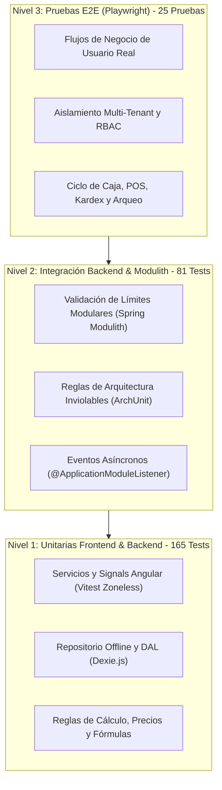

# 🛡️ Bóveda y Manual Operativo de Pruebas

Bienvenido al centro de gobernanza y aseguramiento de calidad del **Sistema de Gestión de Restaurante (POS + ERP)**. Este directorio contiene los estándares, inventarios y guías de ejecución para garantizar la estabilidad del software en cada entrega.

---

## 📚 Documentos de la Bóveda

1. [**`inventario_de_pruebas.md`**](./inventario_de_pruebas.md):
   - **Inventario maestro de casos de prueba** (25 casos automatizados y catálogo de flujos futuros).
   - **Protocolo obligatorio de entrega** para nuevas funcionalidades.
   - Plantilla estándar para documentar nuevas pruebas.

2. [**`e2e-testing-guide.md`**](./e2e-testing-guide.md):
   - **Guía detallada de ejecución E2E** con Playwright y Chrome DevTools Protocol (CDP).
   - Comandos de terminal, parámetros soportados (`--headed`, `--ui`, `--report`) y modo interactivo.
   - Configuración de entornos y resolución de problemas comunes.

---

## ⚡ Comandos Rápidos de Ejecución (Cheat Sheet)

### 1. Ejecutar Regresión Completa (Recomendado)
Desde la raíz del repositorio:
```bash
# Verifica automáticamente los servicios y corre las 25 pruebas
./scripts/run-e2e.sh
```

### 2. Ejecutar un Flujo Específico
```bash
# Ejecutar únicamente el ciclo completo de turno y arqueo
./scripts/run-e2e.sh shift-lifecycle.spec.ts

# Ejecutar únicamente las pruebas del Punto de Venta
./scripts/run-e2e.sh pos.spec.ts
```

### 3. Modo Visual e Interactivo (Playwright UI)
```bash
cd frontend
npm run test:e2e:ui
```

### 4. Modo Live contra Chrome Abierto (Puerto 9222)
Si tienes Google Chrome abierto con `--remote-debugging-port=9222`:
```bash
node scripts/e2e/run_shift_session_flow.js
```

---

## 🔄 Pirámide de Pruebas del Proyecto


