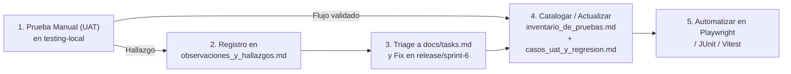

# 🛡️ Bóveda y Manual Operativo de Pruebas

Centro de gobernanza de calidad del **Sistema Integral de Gestión de Restaurante (ERP Angular + Backend Spring Modulith + Backoffice React)** bajo el estándar **[ADR-0017](../adr/0017_multilevel_testing_governance_and_automation_standard.md)** y [testing-governance.md](../../.agents/rules/testing-governance.md).

---

## 📚 Documentos Activos

1. [**`inventario_de_pruebas.md`**](./inventario_de_pruebas.md)
   - Matriz maestra categorizada por **Aplicación / Módulo** y **Nivel (N1–N4)**.
   - Distingue claramente qué flujos ya están **automatizados** y cuáles están en **UAT manual / pendientes de automatización E2E**.
2. [**`casos_uat_y_regresion.md`**](./casos_uat_y_regresion.md)
   - Especificación paso a paso de los flujos críticos de negocio, casos E2E y escenarios de **Pruebas de Usuario (UAT)** de Sprint 5 y Sprint 6.
3. [**`e2e-testing-guide.md`**](./e2e-testing-guide.md)
   - Guía técnica de ejecución de **Playwright (POM)**, comandos, requisitos (`dev` vs `testing-local`) y reglas anti-flakiness.
4. [**`observaciones_y_hallazgos.md`**](../observaciones_y_hallazgos.md)
   - Inbox de triage donde se registran hallazgos de pruebas manuales antes de convertirlos en tareas y pruebas automatizadas.

### 📁 Archivo Histórico (`historico/`)
- **Sprint 3:** [`reporte_ejecucion_sprint3.md`](./historico/reporte_ejecucion_sprint3.md)
- **Sprint 4:** [`bateria_pruebas_sprint4.md`](./historico/bateria_pruebas_sprint4.md) | [`reporte_ejecucion_sprint4.md`](./historico/reporte_ejecucion_sprint4.md)
- **Sprint 5:** [`bateria_pruebas_sprint5.md`](./historico/bateria_pruebas_sprint5.md) | [`reporte_ejecucion_sprint5.md`](./historico/reporte_ejecucion_sprint5.md)
- **Sprint 6 (DevSecOps & Docker):** [`reporte_ejecucion_sprint6.md`](./historico/reporte_ejecucion_sprint6.md)

---

## 🔄 Flujo de Trabajo: Pruebas de Usuario (UAT) $\rightarrow$ Automatización



---

## 🏆 Trofeo de Pruebas y Métricas Actuales (ADR-0017)

| Nivel | Capa | Herramienta | Cobertura Verificada |
| :--- | :--- | :--- | :--- |
| **Nivel 4 (E2E)** | Flujos críticos cross-módulo | Playwright (`frontend/e2e/`) | **7 archivos `.spec.ts` / 34 tests** + suite UAT en curso |
| **Nivel 3 (Integración)** | Spring Modulith, Flyway, API REST | Spring Boot Test + ArchUnit | **Backend total: 191 tests** (`./mvnw clean test`) |
| **Nivel 2 (Componentes)** | Signals, UI Kit, React pages | Vitest (Angular + React RTL) | **ERP: 43 archivos / 377 tests** \| **Backoffice: 4 archivos / 11 tests** |
| **Nivel 1 (Dominio)** | Fórmulas, Kardex, JWT, Storage | JUnit 5 + Vitest | Integrado en suites Backend y Frontend |

---

## ⚡ Comandos Rápidos de Certificación

```bash
# 1. Backend (Unit + Integración + Spring Modulith)
cd backend && ./mvnw clean test

# 2. ERP Frontend (Lint + Vitest)
cd frontend && npm run lint && npm test -- --watch=false

# 3. Backoffice Frontend (Lint + Vitest + Build)
cd backoffice-frontend && npm run lint && npm test && npm run build

# 4. E2E Playwright (contra entorno activo)
./scripts/run-e2e.sh
```
