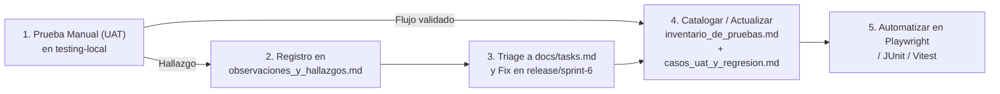

# 🛡️ Bóveda y Manual Operativo de Pruebas

Centro de gobernanza de calidad del **Sistema Integral de Gestión de Restaurante (ERP Angular + Backend Spring Modulith + Backoffice React)** bajo el estándar **[ADR-0017](../adr/0017_multilevel_testing_governance_and_automation_standard.md)** y [testing-governance.md](../../.agents/rules/testing-governance.md).

---

## 📚 Documentos Activos

1. [**`inventario_de_pruebas.md`**](./inventario_de_pruebas.md)
   - Matriz maestra categorizada por **Aplicación / Módulo** y **Nivel (N1–N4)**, más el registro exhaustivo de todas las suites automatizadas del repositorio (`49` clases Backend, `43` specs ERP, `11` suites Backoffice, `7` specs Playwright).
2. [**`casos_uat_y_regresion.md`**](./casos_uat_y_regresion.md)
   - Especificación paso a paso de los flujos críticos de negocio, casos E2E y **bitácora viva de escenarios UAT** validados en `testing-local` (incluyendo `TASK-628`–`TASK-635`).
3. [**`e2e-testing-guide.md`**](./e2e-testing-guide.md)
   - Guía técnica de ejecución de **Playwright (POM)**, comandos, requisitos (`dev` vs `testing-local`) y brecha pendiente de parametrización para correr contra `http://app.localhost`.
4. [**`observaciones_y_hallazgos.md`**](../observaciones_y_hallazgos.md)
   - Bitácora de triage de hallazgos manuales (ciclo Sprint 6 archivado tras completar `TASK-614`–`TASK-635`).

### 📁 Archivo Histórico (`historico/`)
- **Sprint 3:** [`reporte_ejecucion_sprint3.md`](./historico/reporte_ejecucion_sprint3.md)
- **Sprint 4:** [`bateria_pruebas_sprint4.md`](./historico/bateria_pruebas_sprint4.md) | [`reporte_ejecucion_sprint4.md`](./historico/reporte_ejecucion_sprint4.md)
- **Sprint 5:** [`bateria_pruebas_sprint5.md`](./historico/bateria_pruebas_sprint5.md) | [`reporte_ejecucion_sprint5.md`](./historico/reporte_ejecucion_sprint5.md)
- **Sprint 6 (Cloud Prep, DevSecOps & Estabilización MVP v1):** [`reporte_ejecucion_sprint6.md`](./historico/reporte_ejecucion_sprint6.md)

---

## 🔄 Flujo de Trabajo: Pruebas de Usuario (UAT) $\rightarrow$ Automatización



---

## 🏆 Trofeo de Pruebas y Métricas Verificadas (`release/sprint-6`, Migraciones `V1`–`V24`)

| Nivel | Capa | Herramienta | Cobertura Verificada en Repositorio |
| :--- | :--- | :--- | :--- |
| **Nivel 4 (E2E)** | Flujos críticos cross-módulo | Playwright (`frontend/e2e/`) | **7 archivos `.spec.ts` / 34 tests + 4 Page Objects** *(ver nota `testing-local` en guía E2E)* |
| **Nivel 3 (Integración)** | Spring Modulith, Flyway (`V1`–`V24`), API REST | Spring Boot Test + ArchUnit | **Backend: 49 clases Surefire / 213 `@Test` pasando** (`./mvnw clean test`) |
| **Nivel 2 (Componentes)** | Signals, UI Kit, React pages | Vitest (Angular + React RTL) | **ERP: 43 archivos `.spec.ts` / 390 tests** \| **Backoffice: 11 archivos `.test.*` / 22 tests** |
| **Nivel 1 (Dominio)** | Fórmulas, Kardex, JWT, Storage, Catálogo | JUnit 5 + Vitest | Integrado en las suites verificadas de Backend (213), ERP (390) y Backoffice (22) |

---

## ⚡ Comandos Rápidos de Certificación

```bash
# 1. Backend (49 clases / 213 tests + Spring Modulith)
cd backend && ./mvnw clean test

# 2. ERP Frontend (Lint + 43 archivos / 390 tests Vitest)
cd frontend && npm run lint && npm test -- --watch=false

# 3. Backoffice Frontend (Lint + 11 archivos / 22 tests Vitest + Build)
cd backoffice-frontend && npm run lint && npm test && npm run build

# 4. E2E Playwright (7 suites / 34 tests contra entorno dev :4200/:8080)
./scripts/run-e2e.sh
```
