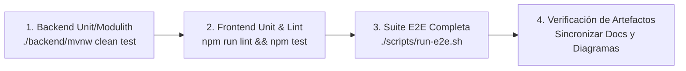

# 🧪 Inventario Maestro de Pruebas y Matriz de Regresión

Este documento es el **artefacto vivo** que inventaría la totalidad de pruebas del sistema (funcionales, transaccionales, de seguridad y de regresión). **Debe ser actualizado y ampliado cada vez que se implemente una nueva funcionalidad** en el producto.

---

## 1. Protocolo Obligatorio de Calidad (Checklist de Entrega)

Antes de dar por concluida cualquier tarea (`TASK-xxx`) o mezclar a la rama principal (`main`), es **estrictamente obligatorio** ejecutar la siguiente secuencia sin excepciones:



- [ ] **Backend 100% Verde:** `./backend/mvnw clean test` (Spring Boot + Spring Modulith verification + ArchUnit).
- [ ] **Frontend 100% Verde:** `cd frontend && npm run lint && npm test -- --watch=false` (Vitest y ESLint sin warnings).
- [ ] **Regresión E2E 100% Verde:** `./scripts/run-e2e.sh` (25/25 pruebas en Playwright pasando).
- [ ] **Inventario Actualizado:** Si la tarea agrega un nuevo flujo o altera uno existente, este documento debe reflejar el nuevo caso de prueba y su script asociado.

---

## 2. Matriz de Casos de Prueba Automatizados

| ID Caso | Módulo | Descripción / Flujo | Tipo | Automatizado | Archivo Ejecutable |
|---|---|---|---|---|---|
| **TC-AUTH-001** | Seguridad | Carga inicial, branding y formulario de login | E2E UI | ✅ Sí | `frontend/e2e/auth.spec.ts` |
| **TC-AUTH-002** | Seguridad | Alternancia de tema Claro / Oscuro (`ThemeService`) | E2E UI | ✅ Sí | `frontend/e2e/auth.spec.ts` |
| **TC-AUTH-003** | Seguridad | Redirección por rol `ADMIN_TENANT` a `/company` | E2E / RBAC | ✅ Sí | `frontend/e2e/auth.spec.ts` |
| **TC-AUTH-004** | Seguridad | Redirección por rol `CASHIER` directo al POS (`/pos`) | E2E / RBAC | ✅ Sí | `frontend/e2e/auth.spec.ts` |
| **TC-POS-001** | Ventas / POS | Indicador de conectividad En Línea y catálogo visible | E2E | ✅ Sí | `frontend/e2e/pos.spec.ts` |
| **TC-POS-002** | Ventas / POS | Adición de plato a comanda y cálculo dinámico de total | E2E | ✅ Sí | `frontend/e2e/pos.spec.ts` |
| **TC-POS-003** | Ventas / POS | Selección de modificadores y extras con recargo (`TASK-210`) | E2E / Pricing | ✅ Sí | `frontend/e2e/pos.spec.ts` |
| **TC-POS-004** | Ventas / POS | Cobro en efectivo con cálculo de cambio y emisión de ticket `T-` | E2E Transaccional | ✅ Sí | `frontend/e2e/pos.spec.ts` |
| **TC-POS-005** | Ventas / POS | Venta en Modo Offline (Dexie.js) y sincronización automática | E2E Offline-First | ✅ Sí | `frontend/e2e/pos.spec.ts` |
| **TC-FIN-001** | Finanzas | Visualización de KPIs ejecutivos de turno y saldo de caja | E2E UI | ✅ Sí | `frontend/e2e/finance.spec.ts` |
| **TC-FIN-002** | Finanzas | Desglose de estado de turno activo y fórmulas de arqueo | E2E | ✅ Sí | `frontend/e2e/finance.spec.ts` |
| **TC-FIN-003** | Finanzas | Registro de nuevo gasto de caja chica y reflejo en tabla | E2E Transaccional | ✅ Sí | `frontend/e2e/finance.spec.ts` |
| **TC-FIN-004** | Finanzas | Modal de arqueo y cálculo de diferencia en tiempo real | E2E | ✅ Sí | `frontend/e2e/finance.spec.ts` |
| **TC-INV-001** | Inventario | KPIs de insumos, valorización y alertas de stock mínimo | E2E UI | ✅ Sí | `frontend/e2e/inventory.spec.ts` |
| **TC-INV-002** | Inventario | Tabla de existencias físicas y stock actual por insumo | E2E | ✅ Sí | `frontend/e2e/inventory.spec.ts` |
| **TC-INV-003** | Inventario | Historial de auditoría en Kardex de movimientos | E2E Audit | ✅ Sí | `frontend/e2e/inventory.spec.ts` |
| **TC-INV-004** | Inventario | Ajuste físico de stock con actualización reactiva | E2E Transaccional | ✅ Sí | `frontend/e2e/inventory.spec.ts` |
| **TC-CAT-001** | Catálogo | Navegación entre pestañas Platos, Insumos y Categorías | E2E UI | ✅ Sí | `frontend/e2e/catalog.spec.ts` |
| **TC-CAT-002** | Catálogo | Listado de platos del menú con precios base | E2E | ✅ Sí | `frontend/e2e/catalog.spec.ts` |
| **TC-CAT-003** | Catálogo | Insumos base y categorías asociadas | E2E | ✅ Sí | `frontend/e2e/catalog.spec.ts` |
| **TC-FLOW-001** | End-to-End | 1. Apertura o verificación de turno con fondo inicial (Cajero) | E2E Jornada | ✅ Sí | `frontend/e2e/shift-lifecycle.spec.ts` |
| **TC-FLOW-002** | End-to-End | 2. Venta POS multilínea con extras, Happy Hour y ticket | E2E Jornada | ✅ Sí | `frontend/e2e/shift-lifecycle.spec.ts` |
| **TC-FLOW-003** | End-to-End | 3. Solicitud de gastos en gaveta (Cajero) con estado Pendiente | E2E Jornada | ✅ Sí | `frontend/e2e/shift-lifecycle.spec.ts` |
| **TC-FLOW-004** | End-to-End | 4. Autorización y aprobación de gastos pendientes (Admin) | E2E Jornada | ✅ Sí | `frontend/e2e/shift-lifecycle.spec.ts` |
| **TC-FLOW-005** | End-to-End | 5. Arqueo físico de gaveta, cuadre exacto y cierre de jornada | E2E Jornada | ✅ Sí | `frontend/e2e/shift-lifecycle.spec.ts` |

---

## 3. Detalle de Casos Críticos de Flujo de Negocio

### Caso TC-FLOW-001..005: Ciclo de Vida de Turno y Operación Integral
- **Objetivo:** Asegurar que el ciclo comercial y financiero diario funcione de inicio a fin entre diferentes roles de usuarios sin errores ni discrepancias de gaveta.
- **Precondiciones:**
  - Base de datos sembrada con datos de demostración (`demo-restaurant`, sucursal Central).
  - Usuarios disponibles: `cajero1` (rol `CASHIER`) y `admin` (rol `ADMIN_TENANT`).
- **Pasos de Ejecución:**
  1. *Cajero:* Ingresa al sistema. Si no hay turno abierto, abre turno con Bs. 200.00.
  2. *Cajero:* Ingresa a `/pos`. Agrega al carrito un Combo Burger con Happy Hour (-15%) y una Hamburguesa Clásica con extras de Queso Cheddar (+Bs. 5.00). Procesa cobro exacto en efectivo. Verifica emisión de comprobante `T-XXXX`.
  3. *Cajero:* Ingresa a `/finance` -> Gastos. Registra solicitud de egreso de caja menor con marca de gaveta (`paidFromCashDrawer = true`). Verifica que queda en `PENDING_APPROVAL` y que el cajero **no** tiene botón para autorizar su propio gasto.
  4. *Admin:* Cierra sesión de cajero e ingresa como Administrador. Va a Finanzas y aprueba los gastos en estado pendiente.
  5. *Admin:* Abre el modal de Arqueo y Cierre. Compara el Efectivo Teórico Esperado ($E_{esperado} = F_{inicial} + V_{efectivo} - G_{aprobados}$) e ingresa el conteo físico real exacto. Confirma cierre de turno.
  6. *Verificación Final:* El sistema marca el turno como `CLOSED` y la interfaz queda en estado inicial lista para una nueva jornada (`btn-open-shift-cta`).

---

## 4. Backlog de Pruebas Futuras (Nuevas Funcionalidades)

Conforme se implementen los siguientes bloques y tareas del `product_backlog.md`, se deberán redactar y automatizar los siguientes casos:

| ID Futuro | Iniciativa / Tarea | Alcance a Cubrir | Prioridad |
|---|---|---|---|
| **TC-FUT-001** | Delivery & Llevar (Sprint 3) | Gestión de pedidos para llevar, datos del cliente y despacho | P1 |
| **TC-FUT-002** | Facturación Electrónica (Sprint 3) | Emisión de factura con NIT/CI y código QR fiscal | P1 |
| **TC-FUT-003** | Mermas y Desperdicios (Sprint 3) | Registro de mermas de insumos con deducción directa en Kardex | P2 |
| **TC-FUT-004** | Transferencias entre Sucursales | Envío y recepción de insumos entre almacenes de diferentes sucursales | P2 |
| **TC-FUT-005** | Arqueo Ciego (Blind Count) | Modalidad donde el cajero no ve el saldo teórico antes de contar | P2 |

---

## 5. Plantilla Estándar para Nuevas Pruebas

Al agregar un nuevo caso a este inventario, utilice la siguiente estructura:

```markdown
### [ID-CASO]: [Título Descriptivo del Flujo]
- **Módulo:** (Catalog / POS / Inventory / Finance / Security)
- **Historia / Tarea:** (ej. TASK-211 / PB-021)
- **Roles Involucrados:** (CASHIER / ADMIN_TENANT / etc.)
- **Precondiciones:**
  - Estado inicial requerido de BD, turno o inventario.
- **Pasos:**
  1. Acción 1
  2. Acción 2
- **Resultado Esperado:**
  - Criterio de aceptación verificable con aserción Playwright.
- **Automatizado en:** `frontend/e2e/<nombre>.spec.ts`
```
